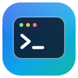
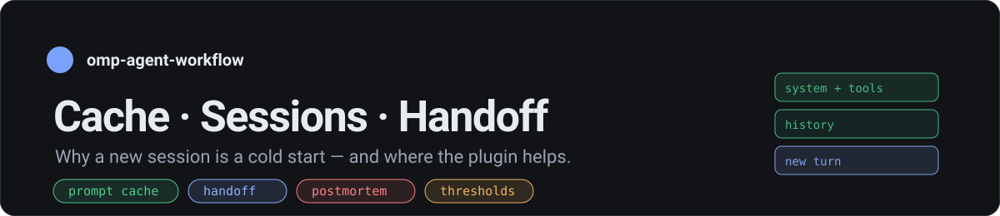
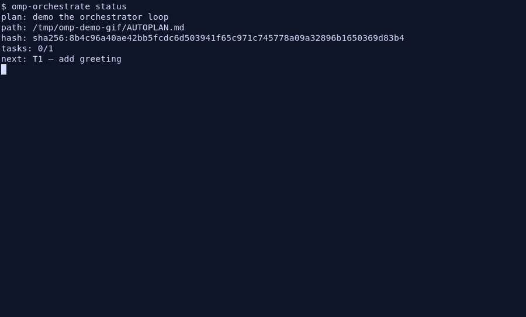
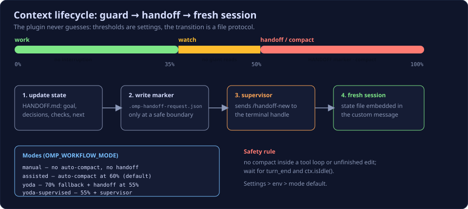
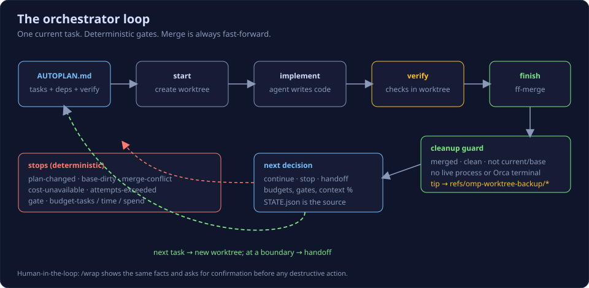
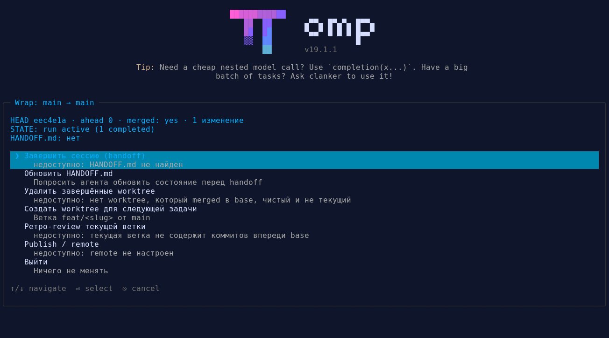
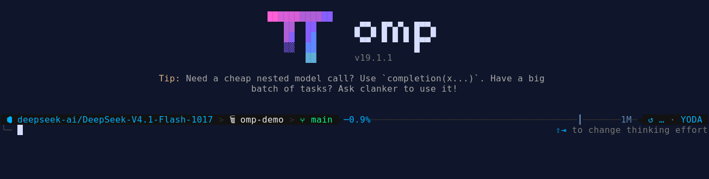
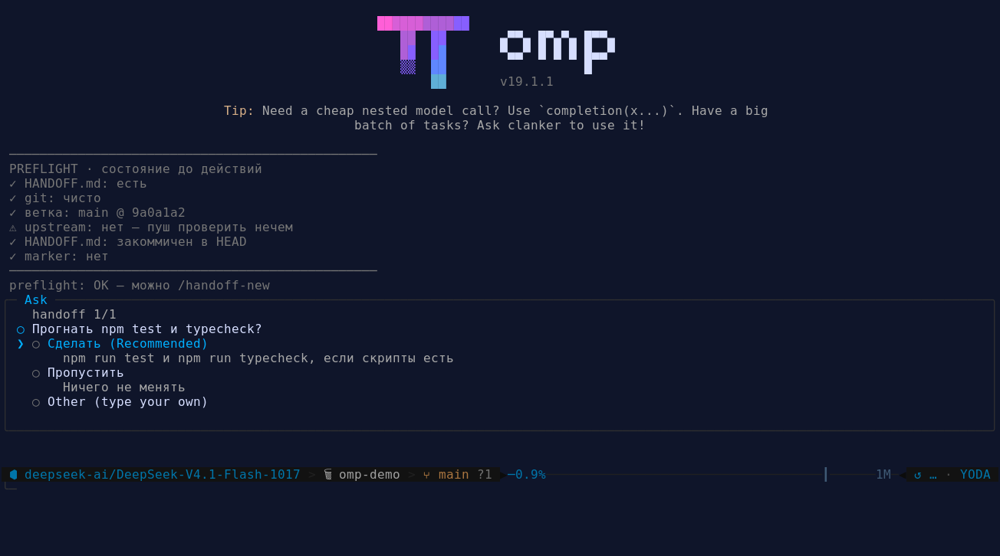
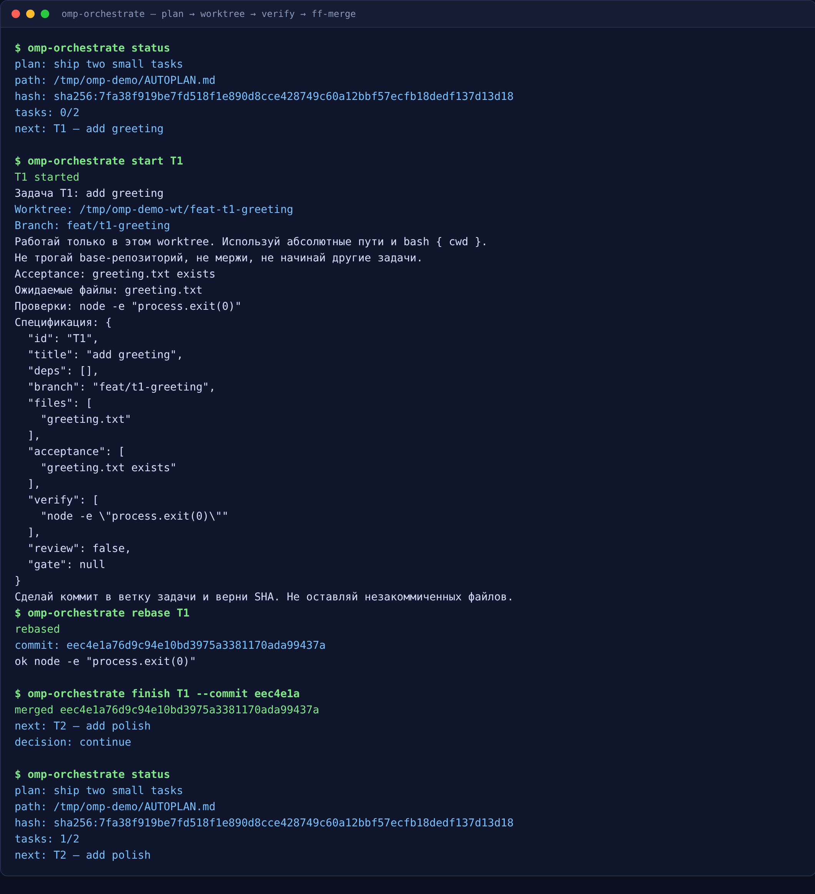
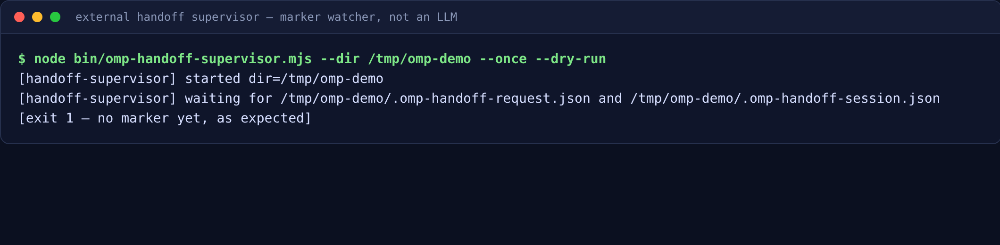

<p align="center">
  
</p>

<h1 align="center">omp-agent-workflow (OAW)</h1>

<p align="center">
  <b>OAW</b> is the short name used in these docs.
</p>

<p align="center">
  Deterministic context guard · true session handoff<br>
  worktree orchestration for <a href="https://github.com/can1357/oh-my-pi">OMP</a>
</p>

<p align="center">
  200+ tests · 0 runtime deps · 4 modes · 13 settings · MIT
</p>

<p align="center">
  <b>English</b> ·
  <a href="README.zh-CN.md">简体中文</a> ·
  <a href="README.ru.md">Русский</a>
</p>

<p align="center">
  <a href="https://github.com/metapeka/omp-agent-workflow/actions/workflows/ci.yml"></a>
  <a href="test"></a>
  <a href="https://github.com/metapeka/omp-agent-workflow/releases"></a>
  <a href="LICENSE"></a>
  <a href="https://github.com/metapeka/omp-agent-workflow/blob/main/package.json"></a>
  <a href="#install"></a>
  <a href="#install"></a>
</p>

<details>
<summary>📑 Contents</summary>

**Start here** · [What you get](#what) · [Install](#install) · [How it works](#how)

**Understand it** · [Why it is different](#why) · [Comparison](#compare) · [Safety](#safety)

**Operate it** · [Commands](#commands) · [Configuration](#config) · [Screenshots](#screens)

**Reference** · [Docs](#docs) · [FAQ](#faq) · [Development](#dev)

</details>

---

Long agent sessions fail at the seams: context runs out, decisions get lost, cleanup destroys work. This plugin makes those seams explicit and reversible.

<p align="center">
  <a href="https://metapeka.github.io/omp-agent-workflow/">
    
  </a>
</p>

<p align="center">
  <strong>Explainer:</strong> English ·
  <a href="https://metapeka.github.io/omp-agent-workflow/ru/">Русский</a> ·
  <a href="https://metapeka.github.io/omp-agent-workflow/zh/">中文</a>
</p>

<details>
<summary>▶️ Watch the 13-second demo</summary>



*Real 13-second recording: `status → start → commit → verify → finish` on a throwaway git repo. The worktree is removed, the branch is kept.*

</details>

<a id="what"></a>
## 🧠 What it is

`omp-agent-workflow` is **not another coding agent**. It is the continuity and discipline layer around the agent you already use:

- 🧭 **Context guard** — warns at 35%, suggests a handoff at 50%, and triggers a deterministic action at 60/70% instead of hoping the model notices.
- 🔁 **Real handoff** — starts a **new session**, embeds `HANDOFF.md` + `STATE.json` into its first message, and continues the task. This is not `/compact` in the same thread.
- 👷 **External supervisor** — a plain Node watcher (not an LLM) that survives the OMP process and sends `/handoff-new` to the terminal handle when the marker appears.
- 🧩 **Orchestrator** — `AUTOPLAN.md` → worktree → implement → verify → fast-forward merge → safe cleanup → next task, with budgets, gates, and stop reasons in `STATE.json`.
- 🛡️ **Safe by default** — cleanup refuses dirty, unmerged, current, live-process, or live-terminal worktrees; the branch tip is saved in a backup ref.
- 🎛️ **Human-in-the-loop `/wrap`** — one menu to finish a session: handoff, cleanup, next worktree, retro-review.

It works with plain OMP. Orca is optional and additive.

---

<a id="why"></a>
## ✨ Why it is different

Most tools optimize **the model call**. This project optimizes **the session boundary** — the moment where agents usually lose decisions, waste context, or destroy work.

| # | Difference | What it means in practice |
|---|---|---|
| 1 | **Deterministic thresholds** | 35/50/60/70% are settings, not vibes. Same behavior on every model. |
| 2 | **Handoff to a fresh session** | The new session starts clean and receives the state file; the old one does not keep dragging a 500k-token history. |
| 3 | **Supervisor outside the agent** | If the OMP session dies, the watcher still exists. It is a file protocol + terminal handle, not a prompt. |
| 4 | **Plan → worktree → verify → merge** | Every task is isolated, checked, and merged ff-only. One `current` task; no silent parallel chaos. |
| 5 | **Cleanup that cannot self-destruct** | Live sessions and current worktrees are hard blockers; branches are retained by default; tips are recoverable. |
| 6 | **OMP-native, Orca-optional** | Settings live in OMP, status uses one extra key, and everything degrades gracefully without Orca. |

> In one sentence: **it makes long agent work resumable, bounded, and reversible.**

---

<a id="compare"></a>
## 📊 How it compares

| Capability | **omp-agent-workflow** | Claude Code | Codex CLI | Aider | OpenCode | Cline | Orca |
|---|---|---|---|---|---|---|---|
| Context budget guard with configurable thresholds | ✅ deterministic 3-zone guard | ⚠️ manual `/compact` / `/clear` | ⚠️ compact + resume | ⚠️ repo map + token budget | ⚠️ built-in context handling | ⚠️ context management | — |
| Handoff to a **fresh** session with state embedded | ✅ new session + state file | ⚠️ resume/compact in the same thread | ⚠️ resume/fork | — | ⚠️ sessions, manual | — | — |
| External supervisor that survives the session | ✅ | — | — | — | — | — | — |
| Plan → worktree → verify → ff-merge loop | ✅ | ⚠️ manual / subagents | ⚠️ manual | ⚠️ manual commits | ⚠️ | ⚠️ | ⚠️ worktrees only |
| Cleanup guard + backup ref | ✅ merged/clean/current/live checks | — | — | — | — | — | ⚠️ worktree remove |
| Human-in-the-loop finish wizard | ✅ `/wrap` | ⚠️ | — | ⚠️ | ⚠️ | ⚠️ | ⚠️ |
| Settings UI + env fallback | ✅ OMP Settings, 13 keys | ✅ | ✅ | ✅ | ✅ | ✅ | ✅ |
| Works as a layer over OMP | ✅ | — own agent | — own agent | — own agent | — own agent | — own agent | ✅ host |

**Legend:** ✅ first-class · ⚠️ manual or partial · — not a documented first-class feature.

*Based on public vendor documentation as of November 2026. This is a capability comparison, not a benchmark. “—” does not mean a tool is bad; it means the capability is not its documented focus.*

### The unique combination

We have not found another tool that does **all five** together:

1. deterministic context budgets,
2. handoff to a **new** session with embedded state,
3. an **external** supervisor,
4. plan/worktree/verify/merge orchestration,
5. a cleanup guard that protects live sessions and keeps recovery cheap.

Each item exists somewhere. The product is the **glue and the guarantees**.

The public landscape study behind this claim — PI, OMP and GitHub, 2026-11-23: [docs/research/market-landscape.md](docs/research/market-landscape.md).

---

<a id="how"></a>
## 🔁 How it works



### Handoff protocol (file-based, no magic)

1. The agent updates `HANDOFF.md`: goal, state, decisions, files, checks, next step.
2. At a safe boundary it writes `.omp-handoff-request.json` (marker).
3. The supervisor sees the marker and sends `/handoff-new` to the terminal handle of the session entry matching `marker.sessionFile` in `.omp-handoff-session.json`.
4. `/handoff-new` builds a new session message from `continuePrompt` + the state file (32k limit, truncation marker, read-error fallback).
5. The new session reads `HANDOFF.md` and continues. No compact event in the middle of a tool loop; the plugin waits for `turn_end` and `ctx.isIdle()`.

Optional **`next-session:` advisory** — the first line of `HANDOFF.md` may carry `v=1 ts=… model=… thinking=… mode=… reason=…`. `bin/omp-yoda` validates it (syntax, 24 h freshness, model against `omp models --json`) and adds `--model`/`--thinking` at process start; explicit flags win, and an invalid, stale, duplicated, or misplaced line changes nothing. `/handoff-preflight` shows the line and its validity. The model is never switched inside a running session.

```text
OMP session A ── marker ──▶ supervisor ── /handoff-new ──▶ OMP session B
      │                                                        │
      └──────────── HANDOFF.md + STATE.json ───────────────────┘
```

### Orchestrator loop



```bash
bin/omp-orchestrate status
bin/omp-orchestrate start T1
# agent works in the printed worktree, commits, returns the SHA
bin/omp-orchestrate verify T1
bin/omp-orchestrate finish T1 --commit <sha> --review ok
bin/omp-orchestrate doctor --json
```

`finish` merges **ff-only** into a clean base, records the commit, then removes the worktree — but only if the cleanup guard agrees. Otherwise it returns a warning and keeps the worktree.

### `/wrap` — finish like a human



The wizard shows the facts first, then offers only actions that make sense. Cleanup candidates must be merged, clean, non-current, outside the base repo, and free of live processes or Orca terminals. Confirmation includes path, branch, and HEAD.

---

<a id="install"></a>
## 🚀 Quick start

**Requirements:** Node.js 22+, OMP 19+, git. Orca is optional.

```bash
# 1. get the code
git clone https://github.com/metapeka/omp-agent-workflow.git
cd omp-agent-workflow

# 2. install dependencies and verify
npm ci
npm run verify

# 3. link it as an OMP plugin
omp plugin link "$PWD"
omp plugin list

# 4. start OMP with the recommended mode
bin/omp-yoda                  # supervisor + OMP in yoda-supervised
# or, without the launcher:
OMP_WORKFLOW_MODE=yoda omp
```

Then use:

```text
/handoff              # OMP builtin: compact with a handoff summary
/handoff-preflight    # check blockers/warnings before a new session
/handoff-new          # start a new session with the state embedded
/wrap                 # finish the task: cleanup, next worktree, retro-review
```

---

<a id="config"></a>
## ⚙️ Configuration

Settings → Plugins → `omp-agent-workflow`. Priority: **Settings > env > mode default**.

| Key | Default | Meaning |
|---|---|---|
| `workflowMode` | `assisted` | `off` / `manual` / `assisted` / `yoda` / `yoda-supervised` |
| `statusEnabled` | `true` | Show the `workflow` status key |
| `handoffAtPercent` | `55` (yoda) / off | Handoff threshold; `0` = off |
| `handoffCooldownSeconds` | `300` | Cooldown after a handoff |
| `contextWarnPercent` | `35` | First warning |
| `contextSuggestPercent` | `50` | Suggest a handoff |
| `autoCompactPercent` | `60` / `70` / off | Auto-compaction threshold |
| `orcaEnabled` | `true` | Orca terminal checks; `false` falls back to git/`/proc` |
| `orcaPreflight` | `true` | Verify the terminal handle before handoff |
| `supervisorEnabled` | `true` | Start the supervisor from `bin/omp-yoda` |
| `continuePrompt` | built-in | First part of the new session message |
| `supervisorRetries` | `3` | Send/preflight retries |
| `supervisorLogLevel` | `info` | `quiet` / `info` / `debug` |

Env fallbacks: `OMP_WORKFLOW_MODE`, `OMP_STATUS_ENABLED`, `OMP_HANDOFF_AT`, `OMP_CONTEXT_*`, `OMP_HANDOFF_COOLDOWN_SECONDS`, `OMP_ORCA_ENABLED`, `OMP_ORCA_PREFLIGHT`, `OMP_SUPERVISOR_ENABLED`, `OMP_HANDOFF_PROMPT`, `OMP_SUPERVISOR_RETRIES`, `OMP_SUPERVISOR_LOG_LEVEL`, `ORCA_CLI_COMMAND`.

### Modes

| Mode | Auto-compaction | Handoff | Supervisor |
|---|---|---|---|
| `off` | OMP default | off | off |
| `manual` | off | off | off |
| `assisted` (default) | 60% | off | off |
| `yoda` | 70% fallback | 55% | off |
| `yoda-supervised` | 70% fallback | 55% | ✅ |

`off` is the kill switch: the plugin publishes no status key, sends no
warnings, writes no session info, and starts no supervisor; OMP runs with its
own defaults. Explicit thresholds are ignored in this mode, and
`OMP_WORKFLOW_MODE=off` overrides Settings for emergencies.

**Percentages are relative to the active model's context window**
(`ctx.getContextUsage().percent`), not absolute token counts. With a 1M
window, 55% is 550k tokens; with a 100k window the same 55% is 55k. Example
for a 1M window: warn 18% (180k), suggest 25% (250k), handoff 30% (300k),
auto-compaction 60% (600k). The same percentages on a 100k window mean
18k / 25k / 30k / 60k.

Auto-compaction is a fallback: it waits while a handoff can still proceed, and
fires at its threshold after handoff retries are exhausted or when a marker is
left without a live supervisor.

### Status line

One extra key; native `context_pct` is not duplicated.

```text
YODA                  yoda mode
YODA-SUP              yoda-supervised, supervisor alive
YODA-SUP · SUP OFF    supervisor missing
YODA-SUP · T2 verify  orchestrator task T2 is being verified
YODA · ⚠ HANDOFF      handoff threshold reached
```



---

<a id="safety"></a>
## 🛡️ Safety model

- **No compaction mid-turn.** The plugin waits for `turn_end` and `ctx.isIdle()`.
- **One current task.** Parallel tasks are intentionally rejected in 0.5.
- **Merge is ff-only.** Divergence becomes `rebase-required`, not a silent merge commit.
- **Cleanup is conservative.** It refuses unmerged, dirty, current, live-process, and live-terminal worktrees.
- **Branches are retained by default.** The tip is saved in `refs/omp-worktree-backup/*`; deletion is explicit and uses `git branch -d`.
- **Orca kills PTYs of the removed worktree.** Cleanup from inside the target is a hard error: that is exactly the 2026-11-23 incident where `orca worktree rm` sent SIGTERM to a live OMP session.
- **No runtime dependencies.** Only Node built-ins; dev dependencies are typescript and type definitions.

Detailed engineering notes: [`docs/commands.md`](docs/commands.md), [`docs/operations.md`](docs/operations.md), [`docs/decisions.md`](docs/decisions.md) (Russian).

---

<a id="commands"></a>
## 🧩 Commands

| Command | What it does |
|---|---|
| `/handoff [focus]` | OMP builtin: compact in the background with a handoff summary (alias of `/compact handoff`) |
| `/handoff-preflight [file]` | Read-only checks + a menu of only unresolved actions |
| `/handoff-new [file]` | Start a new session with `continuePrompt` + state file |
| `/wrap` | Human-in-the-loop finish: cleanup, next worktree, review, handoff |
| `/orchestrate [plan]` | Start or continue `AUTOPLAN.md`; per-task actions live in the `orchestrator` tool |
| `bin/omp-yoda` | Launcher: supervisor + OMP in `yoda-supervised` |
| `bin/omp-handoff-supervisor.mjs` | External marker watcher (not an LLM) |
| `bin/omp-orchestrate` | Headless CLI for the same actions and `doctor` |

---

<a id="screens"></a>
## 🖼️ Screenshots

### `/wrap` — finish the task


The card is enabled only when a merged, clean, non-current worktree without live terminals exists. Everything destructive asks for confirmation.

### `/handoff-preflight` — know before you switch



Blockers are **advisory**: they explain what is missing and offer only actions that are still open. `/handoff-new` does not secretly block on them.

### Real CLI: plan → verify → merge



### The supervisor is a watcher, not a model



> The CLI speaks Russian today; JSON output is language-neutral. Localization is on the roadmap.

---

<a id="docs"></a>
## 📚 Documentation and layout

| Path | Contents |
|---|---|
| [`docs/README.md`](docs/README.md) | Engineering wiki (Russian): architecture, contracts, runbook |
| [`docs/orchestrator.md`](docs/orchestrator.md) | `AUTOPLAN.md`, `STATE.json`, budgets, stop gates |
| [`docs/commands.md`](docs/commands.md) | Command guide: slash commands, orchestrator tool, launcher and supervisor CLI |
| [`docs/operations.md`](docs/operations.md) | Install, supervisor, worktrees, incidents |
| [`docs/decisions.md`](docs/decisions.md) | Accepted decisions and rejected alternatives |
| [`docs/AUTOPLAN.example.md`](docs/AUTOPLAN.example.md) | Copy-paste plan template |
| [`CHANGELOG.md`](CHANGELOG.md) | Release history |
| [`CONTRIBUTING.md`](CONTRIBUTING.md) | Local checks and safety-sensitive areas |
| [`HANDOFF.md`](HANDOFF.md) | Current project state and the SIGTERM incident analysis |
| [`ROADMAP.md`](ROADMAP.md) / [`TODO.md`](TODO.md) | Direction and backlog |

---

<a id="faq"></a>
## ❓ FAQ and limitations

**Is it a coding agent?** No. It is a workflow layer for OMP. You still use your model and agent.

**Does it replace `/compact`?** No, it complements it. `assisted` mode still uses compaction; `yoda` prefers a handoff at 55%.

**Does it require Orca?** No. Orca adds terminal/worktree integration and richer live checks; without it, git and `/proc` fallbacks are used.

**Can I run parallel tasks?** Not in 0.5. One `current` task keeps merge, budgets, and handoff deterministic.

**Will it delete my branch?** Not by default. It keeps the branch and saves the tip in a backup ref. Deletion is explicit and only `git branch -d` after a merged check.

**Are the thresholds measured?** They are heuristics, configurable, and deterministic. Treat them as policy, not physics.

**Why is some UI Russian?** The project started in Russian. English/Chinese docs are the primary entry point now; UI localization is a separate task.

---

<a id="dev"></a>
## 🧪 Development

```bash
npm ci
npm run verify    # 200+ tests + typecheck
```

Tests use real temporary git repositories, no live Orca or model calls. The extension smoke test:

```bash
omp --no-extensions -e ./index.ts -e ./orchestrator.ts \
  --no-session --mode json -p 'Reply with exactly: OK'
```

Contributions: keep behavior changes covered by tests, update docs in the same commit, and never commit session/runtime files.

---

## 📄 License

MIT © 2026 metapeka. See [LICENSE](LICENSE).
