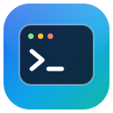
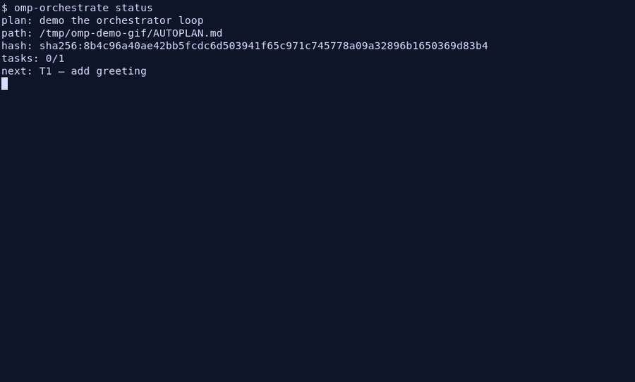
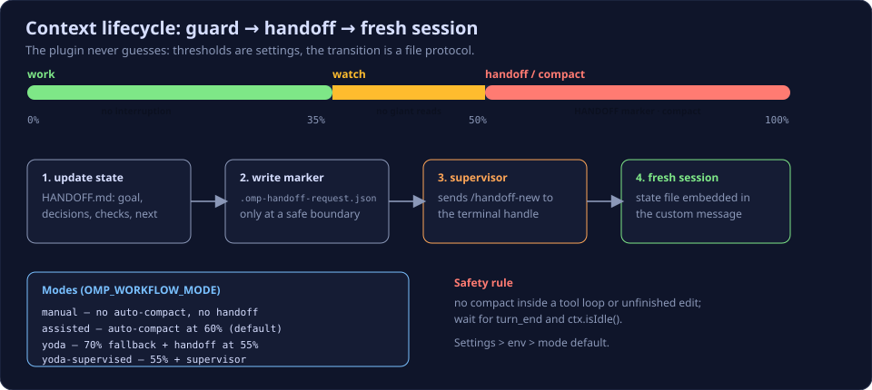
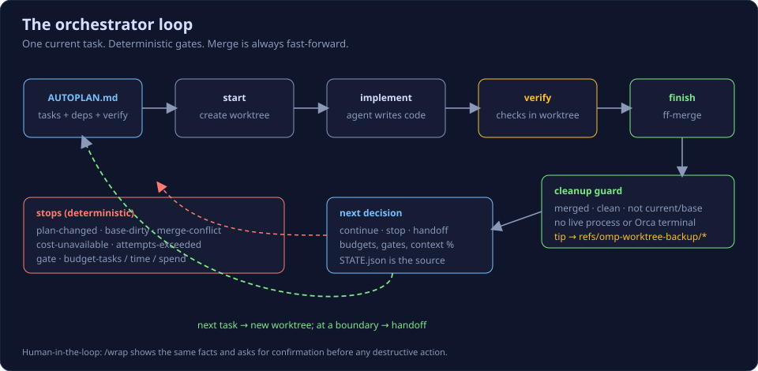
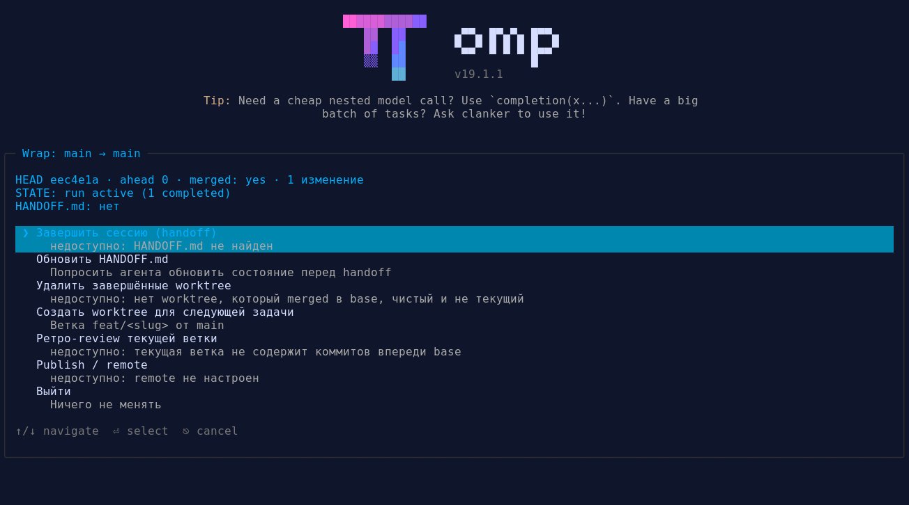
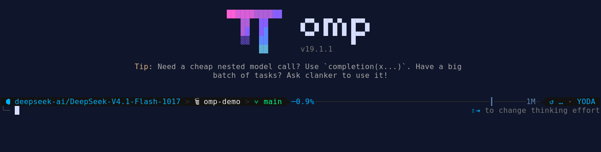
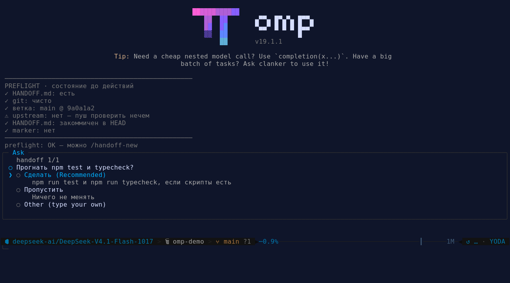
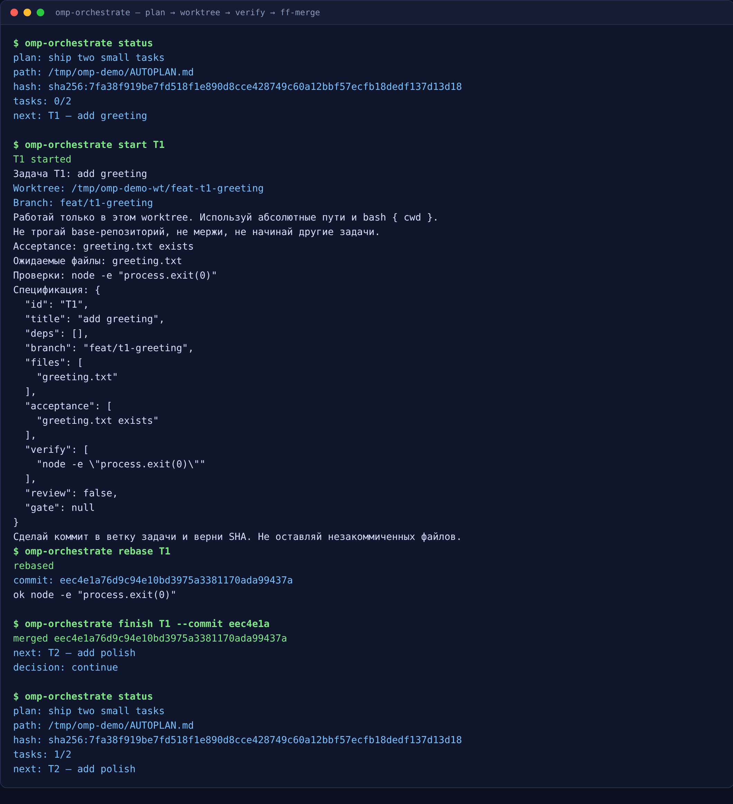
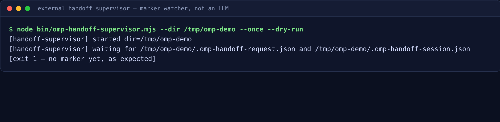

<p align="center">
  
</p>

<h1 align="center">omp-agent-workflow</h1>

<p align="center">
  Детерминированный страж контекста · настоящий handoff<br>
  оркестрация worktree для <a href="https://github.com/can1357/oh-my-pi">OMP</a>
</p>

<p align="center">
  187 тестов · 0 runtime-зависимостей · 4 режима · 13 настроек · MIT
</p>

<p align="center">
  <a href="README.md">English</a> ·
  <a href="README.zh-CN.md">简体中文</a> ·
  <b>Русский</b>
</p>

<p align="center">
  <a href="https://github.com/metapeka/omp-agent-workflow/actions/workflows/ci.yml"></a>
  <a href="test"></a>
  <a href="https://github.com/metapeka/omp-agent-workflow/releases"></a>
  <a href="LICENSE"></a>
  <a href="https://github.com/metapeka/omp-agent-workflow/blob/main/package.json"></a>
  <a href="#install"></a>
  <a href="#install"></a>
</p>

<details>
<summary>📑 Содержание</summary>

**Начать здесь** · [Что это даёт](#what) · [Установка](#install) · [Как работает](#how)

**Понять** · [Чем отличается](#why) · [Сравнение](#compare) · [Безопасность](#safety)

**Работать** · [Команды](#commands) · [Настройки](#config) · [Скриншоты](#screens)

**Справочник** · [Документация](#docs) · [FAQ](#faq) · [Разработка](#dev)

</details>

---

Долгие сессии агента ломаются на стыках: контекст кончается, решения теряются, cleanup уничтожает работу. Этот плагин делает стыки явными и обратимыми.

<details>
<summary>▶️ Смотреть 13-секундное демо</summary>



*Реальная 13-секундная запись: `status → start → commit → verify → finish` на одноразовом git-репозитории. Worktree удалён, ветка сохранена.*

</details>

<a id="what"></a>
## 🧠 Что это

`omp-agent-workflow` — **не ещё один кодирующий агент**. Это слой непрерывности и дисциплины вокруг агента, которым ты уже пользуешься:

- 🧭 **Context guard** — предупреждает на 35%, предлагает handoff на 50% и выполняет детерминированное действие на 60/70%, вместо того чтобы надеяться, что модель заметит сама.
- 🔁 **Настоящий handoff** — запускает **новую сессию**, встраивает `HANDOFF.md` + `STATE.json` в первое сообщение и продолжает задачу. Это не `/compact` в том же потоке.
- 👷 **Внешний supervisor** — обычный Node-watcher (не LLM), который переживает процесс OMP и отправляет `/handoff-new` в terminal handle, когда появляется marker.
- 🧩 **Оркестратор** — `AUTOPLAN.md` → worktree → реализация → verify → ff-merge → безопасный cleanup → следующая задача; бюджеты, gate'ы и причины stop'ов лежат в `STATE.json`.
- 🛡️ **Безопасно по умолчанию** — cleanup отказывает грязным, невлитым, текущим worktree, а также worktree с живыми процессами или терминалами; tip ветки сохраняется в backup-ref.
- 🎛️ **Human-in-the-loop `/wrap`** — одно меню для завершения сессии: handoff, cleanup, следующий worktree, ретро-review.

Работает с обычным OMP. Orca — опциональное усиление.

---

<a id="why"></a>
## ✨ Чем отличается

Большинство инструментов оптимизируют **вызов модели**. Этот проект оптимизирует **границу сессии** — место, где агенты обычно теряют решения, жгут контекст или уничтожают работу.

| # | Отличие | Что это значит на практике |
|---|---|---|
| 1 | **Детерминированные пороги** | 35/50/60/70% — это настройки, а не «ощущение». Поведение одинаково на любой модели. |
| 2 | **Handoff в свежую сессию** | Новая сессия стартует с чистого контекста и получает state-файл; старая не тянет за собой историю на 500k токенов. |
| 3 | **Supervisor вне агента** | Если сессия OMP умерла, watcher остался. Это файловый протокол + terminal handle, а не промпт. |
| 4 | **План → worktree → verify → merge** | Каждая задача изолирована, проверена и влита только ff-only. Один `current`; никакого тихого параллельного хаоса. |
| 5 | **Cleanup, который не может убить себя** | Живые сессии и текущий worktree — жёсткий отказ; ветки по умолчанию остаются; tip'ы восстановимы. |
| 6 | **OMP-native, Orca-optional** | Настройки в OMP, в статус-строке один дополнительный ключ, без Orca всё деградирует мягко. |

> Одной фразой: **долгая работа агента становится возобновляемой, ограниченной и обратимой.**

---

<a id="compare"></a>
## 📊 Сравнение

| Возможность | **omp-agent-workflow** | Claude Code | Codex CLI | Aider | OpenCode | Cline | Orca |
|---|---|---|---|---|---|---|---|
| Context guard с настраиваемыми порогами | ✅ детерминированные 3 зоны | ⚠️ ручные `/compact` / `/clear` | ⚠️ compact + resume | ⚠️ repo map + token budget | ⚠️ встроенное управление | ⚠️ управление контекстом | — |
| Handoff в **новую** сессию со встроенным state | ✅ новая сессия + state-файл | ⚠️ resume/compact в том же потоке | ⚠️ resume/fork | — | ⚠️ сессии, вручную | — | — |
| Внешний supervisor, переживающий сессию | ✅ | — | — | — | — | — | — |
| План → worktree → verify → ff-merge | ✅ | ⚠️ вручную / subagents | ⚠️ вручную | ⚠️ ручные коммиты | ⚠️ | ⚠️ | ⚠️ только worktree |
| Cleanup guard + backup-ref | ✅ merged/clean/current/live | — | — | — | — | — | ⚠️ worktree remove |
| Мастер завершения с подтверждением | ✅ `/wrap` | ⚠️ | — | ⚠️ | ⚠️ | ⚠️ | ⚠️ |
| Settings UI + env fallback | ✅ OMP Settings, 13 ключей | ✅ | ✅ | ✅ | ✅ | ✅ | ✅ |
| Работает слоем над OMP | ✅ | — свой агент | — свой агент | — свой агент | — свой агент | — свой агент | ✅ хост |

**Легенда:** ✅ first-class · ⚠️ вручную или частично · — не заявлено как first-class.

*По публичной документации вендоров на ноябрь 2026. Это сравнение возможностей, не бенчмарк. «—» не значит «плохо»; значит, что это не документированный фокус инструмента.*

### Уникальная комбинация

Мы не нашли другой инструмент, который делает **все пять** вещей сразу:

1. детерминированные бюджеты контекста,
2. handoff в **новую** сессию со встроенным state,
3. **внешний** supervisor,
4. оркестрацию plan/worktree/verify/merge,
5. cleanup guard, который защищает живые сессии и делает recovery дешёвым.

По отдельности это есть у разных продуктов. Ценность — в **склейке и гарантиях**.

Публичный обзор рынка, на котором основан вывод — PI, OMP и GitHub, 2026-11-23: [docs/research/market-landscape.ru.md](docs/research/market-landscape.ru.md).

---

<a id="how"></a>
## 🔁 Как это работает



### Протокол handoff (файловый, без магии)

1. Агент обновляет `HANDOFF.md`: цель, состояние, решения, файлы, проверки, следующий шаг.
2. На безопасной границе пишет `.omp-handoff-request.json` (marker).
3. Supervisor видит marker и отправляет `/handoff-new` в terminal handle из `.omp-handoff-session.json`.
4. `/handoff-new` собирает сообщение новой сессии из `continuePrompt` + state-файла (лимит 32k, маркер обрезки, fallback при ошибке чтения).
5. Новая сессия читает `HANDOFF.md` и продолжает. Компакции посреди tool-loop нет: плагин ждёт `turn_end` и `ctx.isIdle()`.

```text
OMP сессия A ── marker ──▶ supervisor ── /handoff-new ──▶ OMP сессия B
      │                                                       │
      └──────────── HANDOFF.md + STATE.json ──────────────────┘
```

### Цикл оркестратора



```bash
bin/omp-orchestrate status
bin/omp-orchestrate start T1
# агент работает в напечатанном worktree, коммитит и возвращает SHA
bin/omp-orchestrate verify T1
bin/omp-orchestrate finish T1 --commit <sha> --review ok
```

`finish` делает **ff-only** merge в чистый base, записывает commit и удаляет worktree — но только если cleanup guard согласен. Иначе возвращает warning и оставляет worktree.

### `/wrap` — завершить как человек



Мастер сначала показывает факты, затем предлагает только осмысленные действия. Кандидаты на cleanup обязаны быть merged, clean, не текущими, вне base repo и без живых процессов или терминалов Orca. В подтверждении есть path, branch и HEAD.

---

<a id="install"></a>
## 🚀 Быстрый старт

**Требования:** Node.js 22+, OMP 19+, git. Orca опциональна.

```bash
# 1. код
git clone https://github.com/metapeka/omp-agent-workflow.git
cd omp-agent-workflow

# 2. зависимости и проверки
npm ci
npm test
npm run typecheck

# 3. подключить как OMP-плагин
omp plugin link "$PWD"
omp plugin list

# 4. запустить OMP в рекомендуемом режиме
bin/omp-yoda                  # supervisor + OMP, yoda-supervised
# или без launcher'а:
OMP_WORKFLOW_MODE=yoda omp
```

Дальше:

```text
/handoff              # обновить HANDOFF.md и запросить handoff
/handoff-preflight    # проверить блокеры/предупреждения перед новой сессией
/handoff-new          # новая сессия со встроенным state
/wrap                 # завершение: cleanup, следующий worktree, ретро-review
```

---

<a id="config"></a>
## ⚙️ Настройки

Settings → Plugins → `omp-agent-workflow`. Приоритет: **Settings > env > режим/дефолт**.

| Ключ | Default | Смысл |
|---|---|---|
| `workflowMode` | `assisted` | `manual` / `assisted` / `yoda` / `yoda-supervised` |
| `statusEnabled` | `true` | Ключ `workflow` в статус-строке |
| `handoffAtPercent` | `55` (yoda) / off | Порог handoff; `0` = off |
| `handoffCooldownSeconds` | `300` | Пауза после handoff |
| `contextWarnPercent` | `35` | Первое предупреждение |
| `contextSuggestPercent` | `50` | Предложить handoff |
| `autoCompactPercent` | `60` / `70` / off | Порог авто-компакции |
| `orcaEnabled` | `true` | Проверки терминалов Orca; `false` → git/`/proc` fallback |
| `orcaPreflight` | `true` | Проверять terminal handle перед handoff |
| `supervisorEnabled` | `true` | Запускать supervisor из `bin/omp-yoda` |
| `continuePrompt` | встроенный | Начало сообщения новой сессии |
| `supervisorRetries` | `3` | Повторы send/preflight |
| `supervisorLogLevel` | `info` | `quiet` / `info` / `debug` |

Env fallback: `OMP_WORKFLOW_MODE`, `OMP_STATUS_ENABLED`, `OMP_HANDOFF_AT`, `OMP_CONTEXT_*`, `OMP_HANDOFF_COOLDOWN_SECONDS`, `OMP_ORCA_ENABLED`, `OMP_ORCA_PREFLIGHT`, `OMP_SUPERVISOR_ENABLED`, `OMP_HANDOFF_PROMPT`, `OMP_SUPERVISOR_RETRIES`, `OMP_SUPERVISOR_LOG_LEVEL`, `ORCA_CLI_COMMAND`.

### Режимы

| Режим | Авто-компакция | Handoff | Supervisor |
|---|---|---|---|
| `manual` | выкл | выкл | выкл |
| `assisted` (default) | 60% | выкл | выкл |
| `yoda` | 70% fallback | 55% | выкл |
| `yoda-supervised` | 70% fallback | 55% | ✅ |

**Проценты считаются от окна активной модели**
(`ctx.getContextUsage().percent`), а не в абсолютных токенах. При окне 1M
55% — это 550k токенов; при окне 100k те же 55% — 55k. Пример для 1M:
warning 18% (180k), suggestion 25% (250k), handoff 30% (300k),
авто-компакция 60% (600k). Те же проценты на окне 100k дают
18k / 25k / 30k / 60k.

### Статус-строка

Один дополнительный ключ; native `context_pct` не дублируется.

```text
YODA                  режим yoda
YODA-SUP              yoda-supervised, supervisor жив
YODA-SUP · SUP OFF    supervisor отсутствует
YODA-SUP · T2 verify  проверяется задача T2
YODA · ⚠ HANDOFF      достигнут порог handoff
```



---

<a id="safety"></a>
## 🛡️ Модель безопасности

- **Никакой компакции посреди хода.** Плагин ждёт `turn_end` и `ctx.isIdle()`.
- **Одна текущая задача.** Параллельные задачи в 0.5 намеренно запрещены.
- **Merge только ff-only.** Расхождение превращается в `rebase-required`, а не в тихий merge commit.
- **Cleanup консервативен.** Отказ для unmerged, dirty, текущего worktree, живых процессов и терминалов.
- **Ветки по умолчанию остаются.** Tip лежит в `refs/omp-worktree-backup/*`; удаление явное и только `git branch -d`.
- **Orca убивает PTY удаляемого worktree.** Cleanup изнутри target — жёсткая ошибка: это ровно инцидент 2026-11-23, когда `orca worktree rm` прислал SIGTERM живой OMP-сессии.
- **Нет runtime-зависимостей.** Только встроенные модули Node; dev-зависимости — typescript и типы.

Подробные инженерные заметки: [`docs/operations.md`](docs/operations.md), [`docs/decisions.md`](docs/decisions.md).

---

<a id="commands"></a>
## 🧩 Команды

| Команда | Что делает |
|---|---|
| `/handoff` | Обновить state и запросить handoff на безопасной границе |
| `/handoff-preflight [file]` | Read-only проверки + меню только незакрытых действий |
| `/handoff-new [file]` | Новая сессия с `continuePrompt` + state-файлом |
| `/wrap` | Завершение с подтверждением: cleanup, следующий worktree, review, handoff |
| `/orchestrate status\|next\|start\|verify\|finish\|rebase\|stop\|resume` | Управление оркестратором |
| `bin/omp-yoda` | Launcher: supervisor + OMP в `yoda-supervised` |
| `bin/omp-handoff-supervisor.mjs` | Внешний marker-watcher (не LLM) |
| `bin/omp-orchestrate` | Headless CLI для тех же действий |

---

<a id="screens"></a>
## 🖼️ Скриншоты

### `/wrap` — завершить задачу


Карточка доступна, только если есть merged, clean, не текущий worktree без живых терминалов. Все разрушительные действия требуют подтверждения.

### `/handoff-preflight` — знать до переключения



Блокеры **advisory**: объясняют, чего не хватает, и предлагают только незакрытые действия. `/handoff-new` не блокируется ими тайно.

### Реальный CLI: план → verify → merge



### Supervisor — watcher, а не модель



> CLI пока говорит по-русски; JSON-вывод нейтрален к языку. Локализация — в планах.

---

<a id="docs"></a>
## 📚 Документация и структура

| Путь | Содержимое |
|---|---|
| [`docs/README.md`](docs/README.md) | Инженерная вики: архитектура, контракты, runbook |
| [`docs/orchestrator.md`](docs/orchestrator.md) | `AUTOPLAN.md`, `STATE.json`, бюджеты, stop-gates |
| [`docs/operations.md`](docs/operations.md) | Установка, supervisor, worktree, инциденты |
| [`docs/decisions.md`](docs/decisions.md) | Принятые решения и отклонённые альтернативы |
| [`docs/AUTOPLAN.example.md`](docs/AUTOPLAN.example.md) | Шаблон плана для копирования |
| [`CHANGELOG.md`](CHANGELOG.md) | История релизов |
| [`CONTRIBUTING.md`](CONTRIBUTING.md) | Локальные проверки и safety-зоны |
| [`HANDOFF.md`](HANDOFF.md) | Текущее состояние и разбор SIGTERM-инцидента |
| [`ROADMAP.md`](ROADMAP.md) / [`TODO.md`](TODO.md) | Направление и backlog |

---

<a id="faq"></a>
## ❓ FAQ и ограничения

**Это кодирующий агент?** Нет. Это workflow-слой для OMP. Модель и агент остаются твоими.

**Заменяет ли он `/compact`?** Нет, дополняет. В `assisted` компакция остаётся; `yoda` предпочитает handoff на 55%.

**Нужна ли Orca?** Нет. Orca даёт интеграцию с терминалами/worktree и более богатые live-проверки; без неё работают git и `/proc` fallback.

**Можно параллельные задачи?** В 0.5 нет. Один `current` держит merge, бюджеты и handoff детерминированными.

**Удалит ли он мою ветку?** По умолчанию нет. Ветка сохраняется, tip пишется в backup-ref. Удаление явное и только `git branch -d` после проверки merged.

**Пороги измерены?** Это настраиваемая эвристика, исполняемая детерминированно. Это политика, не физика.

**Почему часть UI на русском?** Проект начинался на русском. Английская/китайская документация теперь основной вход; локализация UI — отдельная задача.

---

<a id="dev"></a>
## 🧪 Разработка

```bash
npm ci
npm test          # 187 тестов
npm run typecheck
```

Тесты используют реальные временные git-репозитории, без живого Orca и вызовов модели. Smoke-тест расширения:

```bash
omp --no-extensions -e ./index.ts -e ./orchestrator.ts \
  --no-session --no-tools --mode json -p 'Reply with exactly: OK'
```

Вклад: поведенческое изменение — с тестом, docs в том же коммите, session/runtime-файлы не коммитить.

---

## 📄 Лицензия

MIT © 2026 metapeka. См. [LICENSE](LICENSE).
