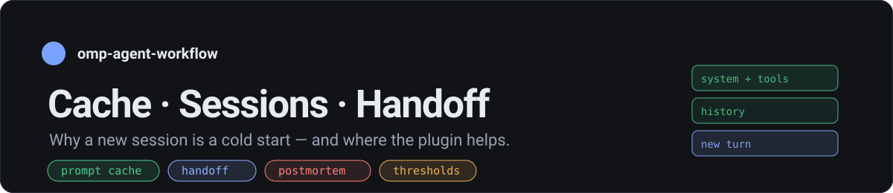
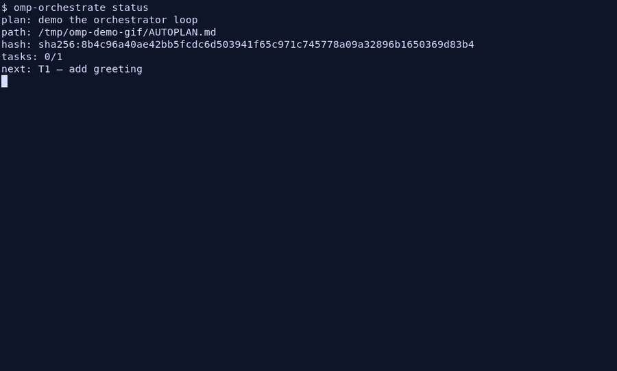
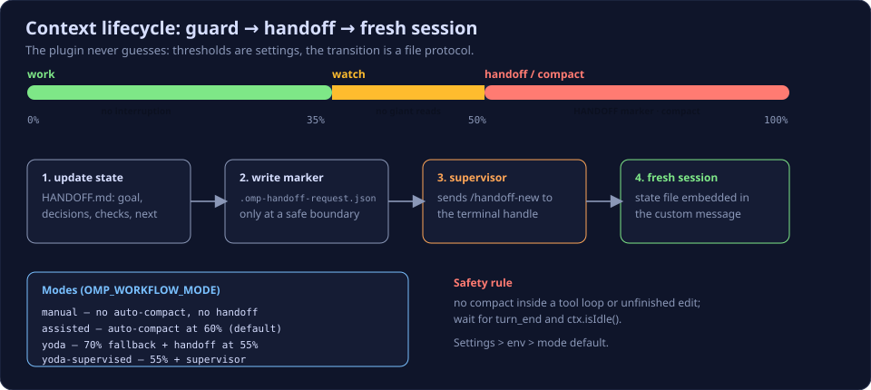
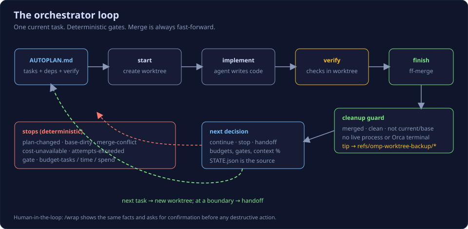
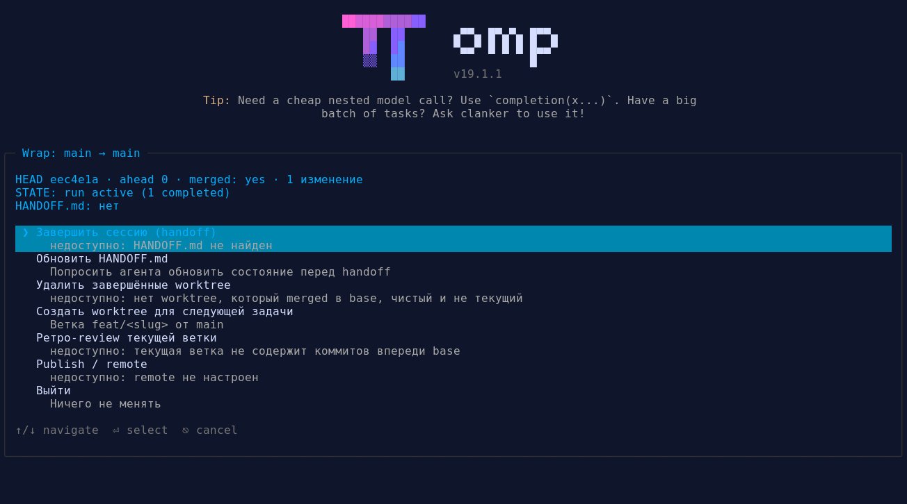
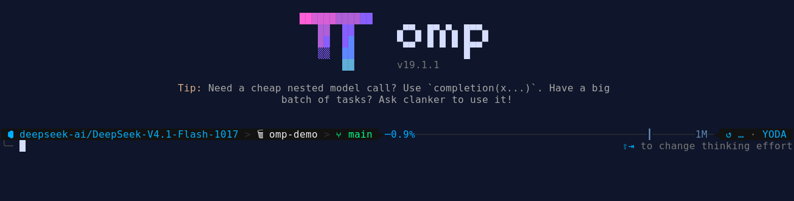
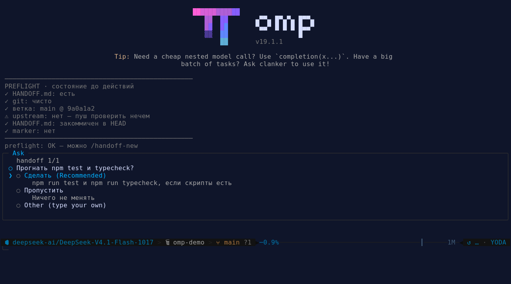
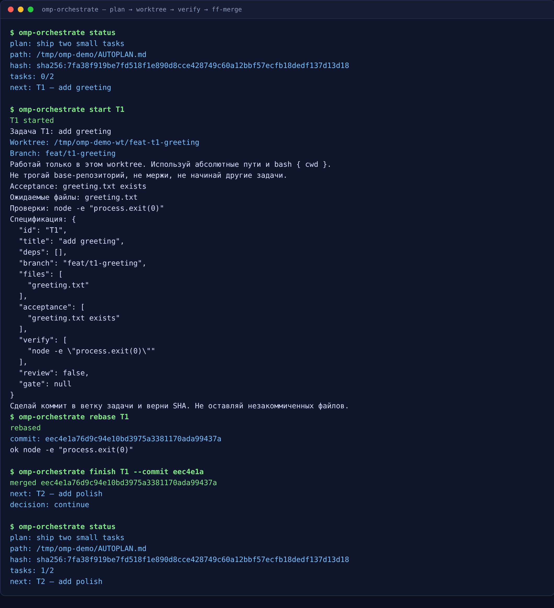
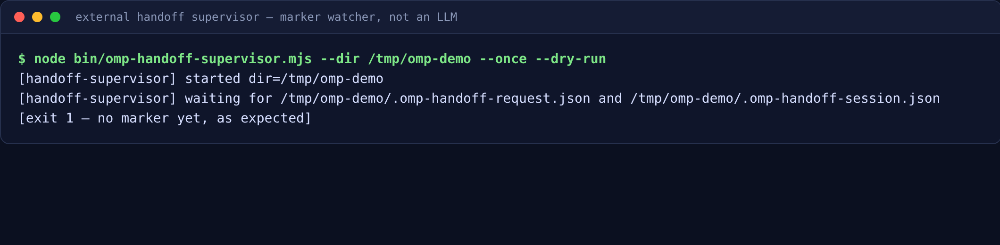

<p align="center">
  
</p>

<h1 align="center">omp-agent-workflow (OAW)</h1>

<p align="center">
  <b>OAW</b> 是这些文档中使用的简称。
</p>

<p align="center">
  确定性上下文守卫 · 真正的会话交接<br>
  面向 <a href="https://github.com/can1357/oh-my-pi">OMP</a> 的 worktree 编排
</p>

<p align="center">
  200+ 个测试 · 0 运行时依赖 · 4 种模式 · 15 项设置 · MIT
</p>

<p align="center">
  <a href="README.md">English</a> ·
  <b>简体中文</b> ·
  <a href="README.ru.md">Русский</a>
</p>

<p align="center">
  <a href="https://github.com/metapeka/omp-agent-workflow/actions/workflows/ci.yml"></a>
  <a href="test"></a>
  <a href="https://github.com/metapeka/omp-agent-workflow/releases"></a>
  <a href="LICENSE"></a>
  <a href="https://github.com/metapeka/omp-agent-workflow/blob/main/package.json"></a>
  <a href="#install"></a>
  <a href="#install"></a>
</p>

<details>
<summary>📑 目录</summary>

**从这里开始** · [你将获得什么](#what) · [安装](#install) · [工作方式](#how)

**理解它** · [与众不同之处](#why) · [与同类工具对比](#compare) · [安全模型](#safety)

**使用它** · [命令](#commands) · [配置](#config) · [截图](#screens)

**参考** · [文档](#docs) · [FAQ](#faq) · [开发](#dev)

</details>

---

长时间代理工作往往死在接缝处：上下文耗尽、决策丢失、清理毁掉成果。这个插件把这些接缝变成显式且可回滚的步骤。

<p align="center">
  <a href="https://metapeka.github.io/omp-agent-workflow/zh/">
    
  </a>
</p>

<p align="center">
  <strong>说明：</strong>
  <a href="https://metapeka.github.io/omp-agent-workflow/">English</a> ·
  <a href="https://metapeka.github.io/omp-agent-workflow/ru/">Русский</a> ·
  中文
</p>

<details>
<summary>▶️ 观看 13 秒演示</summary>



*真实 13 秒录屏：在一次性 git 仓库中执行 `status → start → commit → verify → finish`。worktree 被删除，分支被保留。*

</details>

<a id="what"></a>
## 🧠 这是什么

`omp-agent-workflow` **不是另一个编码代理**。它是你已经使用的代理之外的“连续性与纪律层”：

- 🧭 **上下文守卫** — 35% 警告，50% 建议交接，60/70% 执行确定性动作，而不是指望模型自己发现。
- 🔁 **真正的交接** — 启动一个**全新会话**，把 `HANDOFF.md` + `STATE.json` 嵌入首条消息并继续任务。这不是同一线程里的 `/compact`。
- 👷 **外部守护进程** — 一个普通 Node watcher（不是 LLM），能在 OMP 进程结束后继续存活，并在 marker 出现时向终端 handle 发送 `/handoff-new`。
- 🧩 **编排器** — `AUTOPLAN.md` → worktree → 实现 → 验证 → 快进合并 → 安全清理 → 下一任务；预算、门控和停止原因都记录在 `STATE.json`。支出预算是账本：根会话加 subagent 会话，在 `status --json` 中以 `spend` 呈现。
- 🛡️ **默认安全** — 清理会拒绝未合并、脏、当前、有活进程或活终端的 worktree；分支 tip 会写入备份引用。
- 🎛️ **人工确认 `/wrap`** — 一个菜单完成收尾：交接、清理、创建下一个 worktree、回顾评审。

它可以在纯 OMP 下工作。Orca 是可选的增强。

---

<a id="why"></a>
## ✨ 与众不同之处

大多数工具优化**模型调用**。这个项目优化**会话边界**——代理最容易丢失决策、浪费上下文或毁掉工作的地方。

| # | 差异 | 实际意义 |
|---|---|---|
| 1 | **确定性阈值** | 35/50/60/70% 是设置，不是感觉。换模型也保持一致。 |
| 2 | **交接到全新会话** | 新会话从干净上下文开始并拿到状态文件；旧会话不再拖着 50 万 token 的历史。 |
| 3 | **守护进程在代理之外** | OMP 会话死了，watcher 还活着。它是文件协议 + 终端 handle，不是提示词。 |
| 4 | **计划 → worktree → 验证 → 合并** | 每个任务隔离、可验证、只做 ff-only 合并。同一时间只有一个 `current` 任务。 |
| 5 | **不会自毁的清理** | 活会话和当前 worktree 是硬阻断；分支默认保留；tip 可恢复。 |
| 6 | **OMP 原生，Orca 可选** | 设置放在 OMP，状态只多一个键；没有 Orca 也能优雅降级。 |

> 一句话：**让长时间代理工作可恢复、有边界、可回滚。**

---

<a id="compare"></a>
## 📊 与同类工具对比

| 能力 | **omp-agent-workflow** | Claude Code | Codex CLI | Aider | OpenCode | Cline | Orca |
|---|---|---|---|---|---|---|---|
| 可配置阈值的上下文预算守卫 | ✅ 确定性三段守卫 | ⚠️ 手动 `/compact` / `/clear` | ⚠️ compact + resume | ⚠️ repo map + token 预算 | ⚠️ 内置上下文管理 | ⚠️ 上下文管理 | — |
| 交接给**全新**会话并嵌入状态 | ✅ 新会话 + 状态文件 | ⚠️ 同线程 resume/compact | ⚠️ resume/fork | — | ⚠️ 会话，需手动 | — | — |
| 会话结束后仍存活的外部守护进程 | ✅ | — | — | — | — | — | — |
| 计划 → worktree → 验证 → ff 合并 | ✅ | ⚠️ 手动 / 子代理 | ⚠️ 手动 | ⚠️ 手动提交 | ⚠️ | ⚠️ | ⚠️ 仅 worktree |
| 清理守卫 + 备份引用 | ✅ merged/clean/current/live 检查 | — | — | — | — | — | ⚠️ worktree remove |
| 人工确认收尾向导 | ✅ `/wrap` | ⚠️ | — | ⚠️ | ⚠️ | ⚠️ | ⚠️ |
| 设置 UI + 环境变量回退 | ✅ OMP Settings，15 个键 | ✅ | ✅ | ✅ | ✅ | ✅ | ✅ |
| 作为 OMP 之上的工作流层 | ✅ | — 自有代理 | — 自有代理 | — 自有代理 | — 自有代理 | — 自有代理 | ✅ 宿主 |

**图例：** ✅ 一等能力 · ⚠️ 手动或部分支持 · — 不是其文档中的一等能力。

*基于 2026 年 11 月的公开厂商文档。这是能力对比，不是基准测试。“—”不代表工具不好，只代表该能力不是其重点。*

### 独特的组合

我们还没有发现另一个工具同时做到这五件事：

1. 确定性上下文预算，
2. 交接到**全新**会话并嵌入状态，
3. **外部**守护进程，
4. 计划/worktree/验证/合并的编排，
5. 保护活会话且恢复成本很低的清理守卫。

单项能力各自存在。真正有价值的是**粘合方式与保证**。

该结论背后的公开市场调研——PI、OMP 与 GitHub，2026-11-23：[docs/research/market-landscape.zh-CN.md](docs/research/market-landscape.zh-CN.md)。

专门的对比页——OMP 内置能力与最接近的插件，以及各自适合什么场景：[docs/comparison.zh-CN.md](docs/comparison.zh-CN.md)。

---

<a id="how"></a>
## 🔁 工作方式



### 交接协议（基于文件，无魔法）

1. 代理更新 `HANDOFF.md`：目标、状态、决策、文件、检查、下一步。
2. 在安全边界写入 `.omp-handoff-request.json`（marker）。请求文本包含分支、短 HEAD 和最多六个未提交路径（git 只读，运行时文件已排除），以便 WIP 写入 `HANDOFF.md`。
3. 守护进程看到 marker，向 `.omp-handoff-session.json` 中 `marker.sessionFile` 匹配记录的终端 handle 发送 `/handoff-new`。
4. `/handoff-new` 用 `continuePrompt` + 状态文件构造新会话消息（32k 上限、截断标记、读取失败回退）。
5. 新会话读取 `HANDOFF.md` 并继续。不会在工具循环中间压缩；插件等待 `turn_end` 和 `ctx.isIdle()`。

交接有两个独立触发器：上下文百分比（`handoffAtPercent`）与会话实测花费（`handoffAtSpendUsd`，取 session JSONL 中的 `usage.cost.total`）。花费按 byte offsets 增量读取——每个回合只追加新的尾部，包含子会话；就地重写（大小小于已保存 offset）或压缩时会重算 total，而不是重复相加。`0`/`off` 关闭该触发器；两个触发器共用一个 cooldown、supervisor 路径和 `⚠ HANDOFF` 状态，marker 在上下文触发时（即使同时超花费）写 `reason: "context"`，否则写 `"spend"`。只计算实测金额，不按价目表估算。

可选的 **`next-session:` 建议行** — `HANDOFF.md` 的第一行可写 `v=1 ts=… model=… thinking=… mode=… reason=…`。`bin/omp-yoda` 会校验（语法、24 小时新鲜度、按 `omp models --json` 校验模型），并在启动进程时追加 `--model`/`--thinking`；显式参数优先，无效、过期、重复或不在首行的建议不产生任何变化。`/handoff-preflight` 显示该行及其有效性。运行中的会话绝不会切换模型。

```text
OMP 会话 A ── marker ──▶ 守护进程 ── /handoff-new ──▶ OMP 会话 B
      │                                                   │
      └──────────── HANDOFF.md + STATE.json ──────────────┘
```

### 编排循环



```bash
bin/omp-orchestrate status
bin/omp-orchestrate start T1
# 代理在打印出的 worktree 中工作、提交、返回 SHA
bin/omp-orchestrate verify T1
bin/omp-orchestrate finish T1 --commit <sha> --review ok
bin/omp-orchestrate doctor --json
```

`finish` 只在干净的 base 上做 **ff-only** 合并，记录 commit，然后删除 worktree——但必须通过清理守卫。否则返回 warning 并保留 worktree。

### `/wrap` — 像人一样收尾



向导先展示事实，再只提供有意义的动作。清理候选必须是 merged、clean、非当前、位于 base repo 之外，并且没有活进程或 Orca 终端。确认信息包含 path、branch、HEAD。

---

<a id="install"></a>
## 🚀 快速开始

**要求：** Node.js 22.13+、OMP 19+、git。Orca 可选。

```bash
# 1. 获取代码
git clone https://github.com/metapeka/omp-agent-workflow.git
cd omp-agent-workflow

# 2. 安装依赖并验证
npm ci
npm run verify

# 3. 链接为 OMP 插件
omp plugin link "$PWD"
omp plugin list

# 4. 用推荐模式启动 OMP
bin/omp-yoda                  # supervisor + OMP，yoda-supervised
# 或者不用 launcher：
OMP_WORKFLOW_MODE=yoda omp
```

也支持 tarball？1.0.2 发行版把自包含包作为 asset 提供——无需注册表、无需构建、
无需 `node_modules`：

```bash
curl -LO https://github.com/metapeka/omp-agent-workflow/releases/download/v1.0.2/omp-agent-workflow-1.0.2.tgz
mkdir -p ~/opt/omp-agent-workflow
tar xzf omp-agent-workflow-1.0.2.tgz -C ~/opt/omp-agent-workflow
omp plugin link ~/opt/omp-agent-workflow/package
omp plugin list
```

从克隆中运行 `npm pack` 也能生成同一个包
（`omp-agent-workflow-1.0.2.tgz`），后续 `tar xzf …` 与 `omp plugin link`
步骤相同。

请保留解压目录：launcher 与 CLI 都从那里运行
（`~/opt/omp-agent-workflow/package/bin/omp-yoda`）。
[发布说明](docs/release-notes-1.0.0.md) 列出了已验证步骤；CLI 带自己的 TS
加载器，从 `node_modules`（市场安装副本）也能运行。

更喜欢市场安装？仓库自带目录文件
（[`.omp-plugin/marketplace.json`](.omp-plugin/marketplace.json)）：

```bash
omp plugin marketplace add metapeka/omp-agent-workflow
omp plugin marketplace list        # 用于安装的市场名称
omp plugin install omp-agent-workflow@<marketplace>
```

然后使用：

```text
/handoff              # OMP builtin：压缩并生成交接摘要
/handoff-preflight    # 新会话前检查阻断项/警告
/handoff-new          # 启动嵌入状态的新会话
/wrap                 # 收尾：清理、下一个 worktree、回顾评审
```

---

<a id="config"></a>
## ⚙️ 配置

Settings → Plugins → `omp-agent-workflow`。优先级：**Settings > 环境变量 > 模式默认值**。

| 键 | 默认值 | 含义 |
|---|---|---|
| `workflowMode` | `assisted` | `manual` / `assisted` / `yoda` / `yoda-supervised` |
| `workflowPreset` | `off` | `routine` / `plan` / `review` / `budget`；显式键和参数优先 |
| `statusEnabled` | `true` | 显示 `workflow` 状态键 |
| `handoffAtPercent` | `55`（yoda）/ off | 交接阈值；`0` = 关闭 |
| `handoffAtSpendUsd` | off | 按会话实测花费的交接阈值（$）；`0` = 关闭 |
| `handoffCooldownSeconds` | `300` | 交接后的冷却时间 |
| `contextWarnPercent` | `35` | 第一次警告 |
| `contextSuggestPercent` | `50` | 建议交接 |
| `autoCompactPercent` | `60` / `70` / off | 自动压缩阈值 |
| `orcaEnabled` | `true` | Orca 终端检查；`false` 回退到 git/`/proc` |
| `orcaPreflight` | `true` | 交接前验证终端 handle |
| `supervisorEnabled` | `true` | 允许 `bin/omp-yoda` 启动守护进程 |
| `continuePrompt` | 内置 | 新会话消息的第一段 |
| `supervisorRetries` | `3` | 发送/预检重试次数 |
| `supervisorLogLevel` | `info` | `quiet` / `info` / `debug` |

环境变量回退：`OMP_WORKFLOW_MODE`、`OMP_STATUS_ENABLED`、`OMP_HANDOFF_AT`、`OMP_HANDOFF_AT_USD`、`OMP_CONTEXT_*`、`OMP_HANDOFF_COOLDOWN_SECONDS`、`OMP_ORCA_ENABLED`、`OMP_ORCA_PREFLIGHT`、`OMP_SUPERVISOR_ENABLED`、`OMP_HANDOFF_PROMPT`、`OMP_SUPERVISOR_RETRIES`、`OMP_SUPERVISOR_LOG_LEVEL`、`ORCA_CLI_COMMAND`。

### 模式

| 模式 | 自动压缩 | 交接 | 守护进程 |
|---|---|---|---|
| `off` | OMP 默认 | 关 | 关 |
| `manual` | 关 | 关 | 关 |
| `assisted`（默认） | 60% | 关 | 关 |
| `yoda` | 70% 回退 | 55% | 关 |
| `yoda-supervised` | 70% 回退 | 55% | ✅ |

`off` 是总开关：插件不发布状态键、不发送警告、不写 session info、不启动
守护进程；OMP 按自身默认值运行。该模式下显式阈值被忽略，且
`OMP_WORKFLOW_MODE=off` 会覆盖 Settings，用于紧急关闭。

**百分比相对于当前模型的上下文窗口**
（`ctx.getContextUsage().percent`），不是绝对 token 数。1M 窗口下 55% 是
550k token；100k 窗口下同样的 55% 是 55k。以 1M 窗口为例：警告 18%
（180k）、建议 25%（250k）、交接 30%（300k）、自动压缩 60%（600k）。
同样的百分比在 100k 窗口上分别是 18k / 25k / 30k / 60k。

自动压缩是回退方案：在交接仍可能进行时等待；交接重试耗尽或 marker 没有
存活守护进程后，才按配置阈值执行。

### 状态栏

只增加一个键；原生 `context_pct` 不会重复。

```text
YODA                  yoda 模式
YODA-SUP              yoda-supervised，守护进程存活
YODA-SUP · SUP OFF    守护进程缺失
YODA-SUP · T2 verify  正在验证编排任务 T2
YODA · ⚠ HANDOFF      达到交接阈值
```



---

<a id="safety"></a>
## 🛡️ 安全模型

- **不在回合中间压缩。** 插件等待 `turn_end` 和 `ctx.isIdle()`。
- **同一时间一个当前任务。** 0.5 有意拒绝并行任务。
- **只做 ff-only 合并。** 分叉会变成 `rebase-required`，不会产生静默的 merge commit。
- **清理是保守的。** 拒绝未合并、脏、当前、有活进程、有活终端的 worktree。
- **分支默认保留。** tip 写入 `refs/omp-worktree-backup/*`；删除必须显式并只使用 `git branch -d`。
- **Orca 会杀掉被删除 worktree 的 PTY。** 从目标内部清理是硬错误：这正是 2026-11-23 事故中 `orca worktree rm` 向活着的 OMP 会话发送 SIGTERM 的原因。
- **没有运行时依赖。** 只用 Node 内置模块；开发依赖是 typescript 和类型定义。

详细工程笔记（俄语）：[`docs/commands.md`](docs/commands.md)、[`docs/operations.md`](docs/operations.md)、[`docs/decisions.md`](docs/decisions.md)。

---

<a id="commands"></a>
## 🧩 命令

| 命令 | 作用 |
|---|---|
| `/handoff [focus]` | OMP builtin：后台压缩并生成交接摘要（`/compact handoff` 的别名） |
| `/handoff-preflight [file]` | 只读检查 + 仅列出未解决动作的菜单 |
| `/handoff-new [file]` | 用 `continuePrompt` + 状态文件启动新会话 |
| `/wrap` | 人工确认收尾：清理、下一个 worktree、评审、交接 |
| `/orchestrate [plan]` | 启动/继续 `AUTOPLAN.md`；按任务的动作在 `orchestrator` 工具中 |
| `bin/omp-yoda` | 启动器：守护进程 + OMP（`yoda-supervised`） |
| `bin/omp-handoff-supervisor.mjs` | 外部 marker watcher（不是 LLM） |
| `bin/omp-orchestrate` | 相同动作及 `doctor` 的无头 CLI |

---

<a id="screens"></a>
## 🖼️ 截图

### `/wrap` — 收尾任务


只有当存在 merged、clean、非当前且没有活终端的 worktree 时，卡片才可用。所有破坏性动作都会要求确认。

### `/handoff-preflight` — 切换前先知道



阻断项是**建议性**的：它们解释缺什么，并只提供仍未完成的动作。`/handoff-new` 不会暗中被它们阻塞。

若 `omp-cache-monitor` 在 `PATH` 中（或设置了 `OMP_CACHE_MONITOR_CLI`），表格还会显示来自 `costs --json` 的 handoff 边界价格：冷回合成本中位数对热回合，并在会话使用多个模型时按模型列出。没有 CLI 时不会多出任何行。

### `omp-orchestrate economics` — handoff 的代价

沿 `parentSession` 向上遍历会话链的只读报告；只有带 `handoff` 自定义消息的子会话才算边界，subagent 会话不计。每条边界给出父会话最后 N 回合与子会话最初 N 回合的回合成本中位数和缓存命中率、子会话第一回合的价格，以及回填缓存所需的冷回合数。压缩记录单独列出；没有记录时报告如实说明，而不会编造零。

```bash
bin/omp-orchestrate economics --session "$SESSION" --turns 10
bin/omp-orchestrate economics --summary --session "$SESSION"  # 整链聚合
bin/omp-orchestrate economics --json > economics.json   # schemaVersion 1
```

`--summary` 在逐条边界明细之上增加一行聚合：链中的会话数、handoff 数与已测量的边界数，实际被测量的会话数，已测量的总支出与回合价格中位数，边界首回合的平均价格（及其与普通回合的比值），以及「前/后」窗口的缓存命中率趋势。JSON 增加 `summary` 对象；不带该标志时报告及其 JSON 完全不变。未测量的值保持 `null`；当只有部分会话有价格时，note 会写出 `N из M`，不会把部分合计当作整链支出，也不会编造零。

没有 `--session` 时取 `--dir` 中 `.omp-handoff-session.json` 最新且存活的记录。没有 cache-monitor CLI（或报告损坏）时 `boundaries` 为空并附 note，exit 0；会话不存在为 exit 1，参数错误为 exit 2。不写文件，不走网络。

### 真实 CLI：计划 → 验证 → 合并



### 守护进程是 watcher，不是模型



> CLI 目前输出俄语；JSON 输出与语言无关。本地化在路线图上。

---

<a id="docs"></a>
## 📚 文档与目录

| 路径 | 内容 |
|---|---|
| [`docs/README.md`](docs/README.md) | 工程 wiki（俄语）：架构、契约、runbook |
| [`docs/orchestrator.md`](docs/orchestrator.md) | `AUTOPLAN.md`、`STATE.json`、预算、停止门控 |
| [`docs/commands.md`](docs/commands.md) | 命令指南：斜杠命令、orchestrator 工具、启动器与守护进程 CLI |
| [`docs/operations.md`](docs/operations.md) | 安装、守护进程、worktree、事故 |
| [`docs/decisions.md`](docs/decisions.md) | 已接受决策与被拒方案 |
| [`docs/AUTOPLAN.example.md`](docs/AUTOPLAN.example.md) | 可复制的计划模板 |
| [`CHANGELOG.md`](CHANGELOG.md) | 发布历史 |
| [`docs/release-notes-1.0.0.md`](docs/release-notes-1.0.0.md) | 1.0 发布说明：安装方式、兼容性、已验证的检查 |
| [`CONTRIBUTING.md`](CONTRIBUTING.md) | 本地检查与安全敏感区域 |
| [`HANDOFF.md`](HANDOFF.md) | 当前项目状态与 SIGTERM 事故分析 |
| [`ROADMAP.md`](ROADMAP.md) / [`TODO.md`](TODO.md) | 方向与待办 |

---

<a id="faq"></a>
## ❓ FAQ 与限制

**它是编码代理吗？** 不是。它是 OMP 的工作流层。你仍然使用自己的模型和代理。

**它替代 `/compact` 吗？** 不，它补充它。`assisted` 模式仍使用压缩；`yoda` 更倾向于在 55% 交接。

**需要 Orca 吗？** 不需要。Orca 提供终端/worktree 集成和更丰富的活体检查；没有它时使用 git 与 `/proc` 回退。

**可以并行任务吗？** 0.5 不行。一个 `current` 任务让合并、预算和交接保持确定性。

**会删除我的分支吗？** 默认不会。它保留分支并把 tip 写入备份引用。删除必须显式，且只在 merged 检查后使用 `git branch -d`。

**阈值是测出来的吗？** 是可配置的启发式策略，确定性执行。把它当政策，不要当物理定律。

**为什么有些界面是俄语？** 项目最初使用俄语。现在英/中文文档是主要入口；界面本地化是独立任务。

---

<a id="dev"></a>
## 🧪 开发

```bash
npm ci
npm test          # 200+ 个测试
npm run typecheck
```

测试使用真实临时 git 仓库，不需要活的 Orca 或模型调用。扩展冒烟测试：

```bash
omp --no-extensions -e ./index.ts -e ./orchestrator.ts \
  --no-session --mode json -p 'Reply with exactly: OK'
```

贡献：行为变更必须有测试，文档在同一次提交更新，永远不要提交会话/运行时文件。

---

## 📄 许可证

MIT © 2026 metapeka。见 [LICENSE](LICENSE)。
