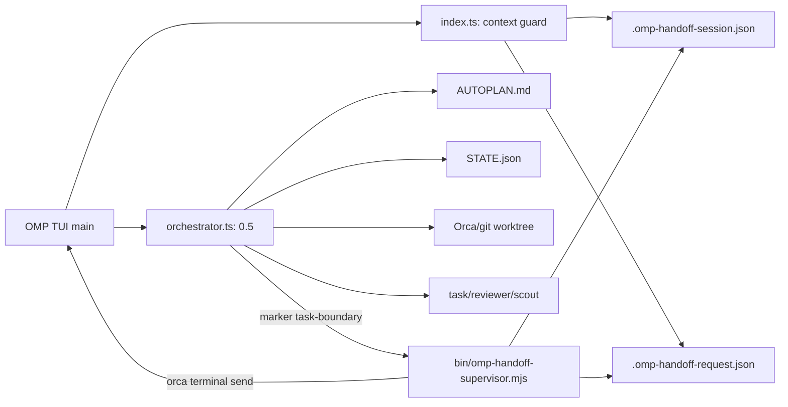

# Архитектура и OMP API

Статус: `[готово]` для 0.3 и 0.5. OMP: `19.1.0`. Orca CLI: локальная
установка проекта.

## Компоненты



| Часть | Путь | Роль |
|---|---|---|
| Context guard | `index.ts` | Пороги 35/50/60, `/handoff`, `/handoff-new`, session info, marker при пороге |
| Supervisor | `bin/omp-handoff-supervisor.mjs` | Внешний watcher: marker + session info → `/handoff-new` |
| Launcher | `bin/omp-yoda` | Supervisor + OMP в `yoda-supervised` |
| Orchestrator `[готово]` | `orchestrator.ts` + `lib/orchestrator/*` | A–D: state, cost, worktree, actions, CLI, extension, E2E |
| Тесты 0.3 | `test/context-guard.test.mjs` | 19 детерминированных тестов guard/handoff |
| Тесты 0.5 | `test/orchestrator.test.mjs` | 37 тестов plan/state/cost/worktree/actions/policy |
| Тесты extension | `test/orchestrator-extension.test.mjs` | 10 тестов tool/commands/hooks |

## Что extension может и не может (OMP 19.1.0)

Факты проверены по типам и исходникам пакета
`node_modules/@oh-my-pi/pi-coding-agent` (19.1.0). При обновлении OMP —
перепроверить.

| Возможность | Факт | Следствие для проекта |
|---|---|---|
| `registerTool`, `registerCommand`, events | Есть в `ExtensionAPI` (`dist/types/extensibility/extensions/types.d.ts:1416`) | Orchestrator получает tool и команды |
| Спавн subagent из extension | Нет API | Implementer/verifier/reviewer спавнит main-агент через `task` |
| `ctx.newSession()` | Только `ExtensionCommandContext` | Смену сессии делает `/handoff-new` или supervisor; event-handler не может |
| `pi.sendUserMessage()` | Есть, очередь при streaming | Продолжение после `agent_end`; handoff-инструкция |
| Factories в subagent-сессиях | «Extension factories are rebound to every subagent session» (`types.d.ts:384`) | Все hooks проверяют `ctx.agent.kind === "main"` и `ctx.mode === "tui"` |
| `task` tool: `cwd`/worktree | В схеме нет (`dist/types/task/types.d.ts:31`) | Subagent работает по абсолютным путям worktree и `bash { cwd }` |
| `task: isolated` | Копия репозитория; изменения применяются обратно автоматически (`src/task/isolation-runner.d.ts`, `mergeIsolatedChanges`) | Не годится для gated-merge: изменения попадут в base до verify/review |
| `bash` | Принимает `cwd` | Verifier/implementer запускают команды в worktree |
| `read`/`write`/`edit` | Принимают абсолютные пути | Изоляция задачи держится на промпте и проверках, не на cwd |
| Context usage | `ctx.getContextUsage()` → `tokens/contextWindow/percent` | Политика handoff/compact; `null` сразу после компакции |
| Spend в контексте | Нет | Считать по session JSONL или полагаться на native `--max-cost` |
| Session JSONL | `message.assistant.usage.cost.total`; дочерние сессии в `<root-session-dir>/*.jsonl` с `parentSession` | Инкрементальный run-бюджет |
| Native cost gate | `omp --max-cost`, `--warn-cost`; учитывает subagents | Жёсткий backstop, но per-session, не run-глобальный |
| Extension entry | `package.json` → `omp.extensions` — массив | 0.5 добавляет второй entry, `index.ts` не трогаем |
| Загрузчик | Bun; относительные `.ts` import ожидаются рабочими | Spike перед этапом C; fallback — импорт ядра из `index.ts` |

### Почему не Orca orchestration

В Orca есть `orca orchestration` (Runs, workers, dispatch, gates). Это
готовый субстрат, но:

- продукт проекта — OMP-расширение, а не надстройка над Orca;
- контракт Orca orchestration может меняться независимо от OMP;
- автоматический handoff уже требует Orca, но basic workflow должен
  работать в обычном TUI.

Решение D1: в 0.5 оркестрация OMP-native. Интеграция с Orca Runs/gates —
`[future]`, этап 0.6+.

## Поток 0.3

1. `session_start` → session info с terminal handle, session file, cwd, pid.
2. `turn_end`/`agent_end` → warning/suggest/auto/handoff по порогам.
3. На `OMP_HANDOFF_AT` extension просит агента завершить задачу, обновить
   `HANDOFF.md` и записать marker.
4. Supervisor видит marker + session info, ждёт idle, отправляет
   `/handoff-new` в terminal handle.
5. `/handoff-new` проверяет `HANDOFF.md`, ждёт idle, вызывает `newSession`,
   добавляет custom message «прочитай HANDOFF.md и продолжи».
6. Cooldown и stale-marker guard не дают циклу повториться.

Детали схем — [contracts.md](contracts.md).

## Поток 0.5 `[готово]`

1. `/orchestrate` → validation, `STATE.json`, первый worktree.
2. Main спавнит implementer (`task`) с абсолютным путём worktree.
3. `orchestrator verify` детерминированно гоняет проверки; verifier
   повторяет независимо.
4. Reviewer смотрит diff; verdict фиксируется в `finish`.
5. `finish` мержит `--ff-only`, удаляет worktree, обновляет state.
6. Policy → continue / handoff / stop. Continue ставит nudge
   `action=start task=<next>`; handoff требует marker `task-boundary`; stop
   фиксирует причину.

Детали — [orchestrator.md](orchestrator.md).

## Источники истины

Порядок доверия:

1. Git, тесты, typecheck, CI.
2. `AUTOPLAN.md` — определения задач и acceptance.
3. `STATE.json` — runtime-прогресс; не коммитится.
4. `HANDOFF.md` — человеческое состояние; коммитится.
5. Summary компакции — кэш, не истина.

Если `STATE.json` потерян, orchestrator останавливается с `state-missing`,
а не переигрывает задачи. Если план изменился — `plan-changed`.

## Границы

- Без runtime-зависимостей и без `any`.
- Не менять контракт 0.3 без решения владельца.
- `omp-cache-monitor` — только read-only интеграция, без переноса кода.
- Публикация npm/marketplace, remote, смена видимости — только по решению
  владельца.
- Один агент — один worktree; `main` — известное хорошее состояние.

## Как перепроверить факты API

```bash
cd ~/projects/omp-agent-workflow
rg -n "interface ExtensionAPI|interface ExtensionContext|registerTool" \
  node_modules/@oh-my-pi/pi-coding-agent/dist/types/extensibility/extensions/types.d.ts
rg -n "taskSchema|isolated" \
  node_modules/@oh-my-pi/pi-coding-agent/dist/types/task/types.d.ts
rg -n "mergeIsolatedChanges|isolation.apply" \
  node_modules/@oh-my-pi/pi-coding-agent/dist/types/task/isolation-runner.d.ts
omp --help | grep -E "max-cost|warn-cost"
orca worktree --help; orca terminal --help
```
