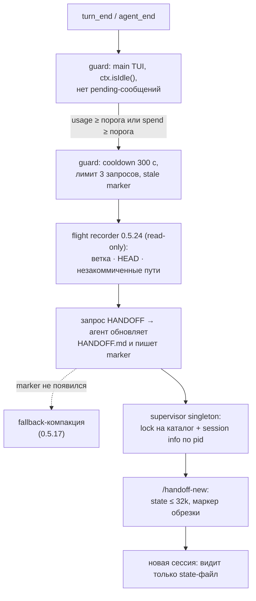

# Защиты OAW: что, зачем и где в цикле

Дата: 2026-11-27. Версия: `0.7.0`. Контракт — [contracts.md](contracts.md),
поток handoff — [handoff-flow.md](handoff-flow.md), диагностика —
[operations.md](operations.md).

OAW решает две разные задачи, и путать их нельзя:

| Задача | Что защищаем | Чем |
|---|---|---|
| **Контекст** | модель не деградирует и не теряет задачу на середине | пороги, handoff, fallback-компакция |
| **Данные** | файлы, ветки, сессии и terminal handle не теряются и не затираются | git-guard'ы, локи, атомарная запись, read-only снимки |

**Handoff — защита контекста, не файлов.** Он не коммитит, не мерджит и не
меняет рабочий каталог: `/handoff-new` открывает новую сессию в том же `cwd`
и вкладывает `continuePrompt` + state-файл. Всё, что защищает дерево от
затирания, стоит в отдельных точках — таблица ниже.

## Цикл и точки защиты



## Угрозы и защиты

| Угроза | Защита | Где срабатывает | С версии |
|---|---|---|---|
| Контекст переполнен, модель теряет задачу | warning 35% / suggest 50% / handoff на пороге; в `yoda-supervised` — 55% | `turn_end`, `agent_end` | 0.1, 0.3 |
| Сессия дорогая, хотя контекст ещё низкий (много коротких ходов/субагентов) | handoff по измеренному `usage.cost.total` (`handoffAtSpendUsd`); тот же cooldown/supervisor/`⚠ HANDOFF`, marker `reason: "spend"`; JSONL дочитывается offsets, перезапись/компакция пересчитывает total (без двойного счёта) | `checkHandoff`, `session_compact` | 0.7.0 |
| Handoff запрошен, но marker не появился | повтор через 2 завершённых хода, максимум 3 запроса, статус `⚠ HANDOFF` | `checkHandoff` | 0.5.15 |
| Handoff завис навсегда (нет supervisor) | fallback-компакция на `autoCompactPercent` после исчерпания повторов | `checkAuto` | 0.5.17 |
| Два supervisor на один каталог перехватывают marker | lock-dir `.omp-handoff-supervisor.lock/`, stale reclaim по мёртвому pid, release на сигналах | старт supervisor'а | 0.5.2 |
| Одноразовый `omp "…"` затирает terminal handle живой сессии | session info — карта по `pid`, merge + dead prune, lock + atomic rename | `session_start`, `session_switch` | 0.5.16 |
| Cleanup worktree убивает SIGTERM'ом живую сессию | guard: merged, clean, не current, нет процессов/JIT-терминалов; без `--force`/`-D`; ветка остаётся, tip в backup-ref | `/wrap`, `finish` | 0.5.14 |
| Commit в preflight утаскивает runtime-файлы или падает на `.gitignore` | add-all, затем снятие `.omp-handoff-*` с индекса; остались — abort | меню preflight | 0.5.23 |
| Незапушенные коммиты | действие `push` в меню preflight (только по выбору, `git push` без `--force`, отказ remote не форсится) | меню preflight | 0.5.26 |
| CLI `costs --json` отсутствует/упал/другая схема | строки `usage-border`/`usage-model` не выводятся; timeout 2 с, строгая проверка `schemaVersion: 1`, preflight не падает | `costsChecks` в preflight | 0.6.0 |
| State раздут и съедает контекст новой сессии | лимит 32 000 символов + маркер обрезки с полным размером и путём | `/handoff-new` | 0.5.8, 0.5.15 |
| State формально есть, но в нём нет цели/решений/проверок — новая сессия слепа | quality gate: warn по строке на отсутствующий ключевой раздел (синонимы, код-блоки не в счёт), одна строка для нестандартного формата; ничего не блокирует | `runPreflight` | 0.7.1 |
| Компакция выбросила детали уже после записи state | warn, если последняя компакция текущей сессии позже mtime `HANDOFF.md`; ручной фикс в блоке «вручную» | `runPreflight` | 0.7.1 |
| **Незакоммиченная работа не видна новой сессии** | **flight recorder: ветка, HEAD и до 6 грязных путей в тексте handoff-запроса** | `checkHandoff` перед `sendUserMessage` | **0.5.24** |
| Плагин мешает, когда не нужен | `workflowMode: off` — ни статуса, ни предупреждений, ни session info, launcher без supervisor | все хуки | 0.5.18 |
| Два владельца задач (`omp` и Ensemble) | `plan.execution: external` → stop `external-run`; `doctor` предупреждает `two owners` | `start/verify/finish/rebase`, `doctor` | 0.5.21 |

## 0.5.24: flight recorder

**Почему.** Handoff физически не может потерять незакоммиченные файлы — они
остаются на диске. Теряется **знание о них**: новая сессия видит только
`HANDOFF.md`, и если там нет строки про WIP, следующий commit смешает
старое и новое. Ошибка была не в том, где стоит handoff, а в том, что снимок
содержал только текст документа.

**Что добавлено.** В момент запроса (`checkHandoff`, последняя безопасная
граница — завершённый ход, `ctx.isIdle()`) extension делает read-only снимок
дерева и вставляет его в текст запроса:

```text
# до 0.5.24
HANDOFF: контекст 56% (56k/100k). Заверши текущую задачу, обнови HANDOFF.md,
запиши .omp-handoff-request.json с {...} и заверши ход. Не начинай новую задачу.

# с 0.5.24
HANDOFF: контекст 56% (56k/100k). Заверши текущую задачу, обнови HANDOFF.md,
запиши .omp-handoff-request.json с {...} и заверши ход.
Дерево: ветка feat/x @ 1a2b3c4, незакоммиченных файлов: 2 (M src/a.ts, ?? b.md).
Перечисли их в HANDOFF.md — новая сессия видит только файл. Не начинай новую задачу.
```

Свойства:

- три git-вызова (`rev-parse --abbrev-ref HEAD`, `rev-parse --short HEAD`,
  `status --porcelain`), timeout 3 с, без записи в репозиторий;
- runtime-файлы `.omp-handoff-*` исключены из списка; чистое дерево даёт
  «изменений нет»; не git-репозиторий — строка просто опускается;
- бюджет: до 6 путей и 300 символов на список, остальное — «и ещё N»;
- контракт файлов marker/session не меняется: снимок живёт только в тексте
  сообщения, модели его видно сразу, новой сессии — только через
  `HANDOFF.md`.

Код: `workingTreeSnapshot()` в `index.ts`; тесты — `test/context-guard.test.mjs`
(грязное дерево, чистое дерево, вне git, исключение runtime-файлов).

## 0.7.1: quality gate в preflight

**Почему.** Handoff передаёт новой сессии ровно один документ. Если в нём
нет цели, решений или проверок, файл существует и `/handoff-new` его
встроит, но следующая сессия начнёт без контекста, который был в старой.
Второй провал — компакция после записи state: разговор сжался, детали
исчезли из сессии, и в документе их уже не восстановить.

**Что добавлено.** Read-only проверки в `runPreflight`, до меню действий:

- шесть канонических разделов README (`цель`, `состояние`, `решения`,
  `файлы`, `проверки`, `дальше`) ищутся по заголовкам ATX и синонимам,
  включая английские; fenced-блоки пропускаются; найденный раздел даёт
  `pass` `разделы 6/6`, каждый отсутствующий — отдельный `warn`;
- нестандартный формат без единого узнаваемого заголовка — одна строка
  `нестандартный формат`, а не шесть предупреждений;
- `lastCompactionAt` из того же прохода по JSONL, что и метрики: если
  последняя компакция позже mtime `HANDOFF.md`, печатается warn; state,
  перезаписанный после компакции, предупреждения не даёт.

Находки не меняют `ready` и не попадают в меню автоматических действий:
точный фикс печатается строкой в блоке «вручную/агентом» и пропускается
вместе с остальными ручными шагами. `/handoff-new` по-прежнему проверяет
только наличие state-файла.

Код: `lib/state-sections.ts`, `stateSectionsChecks`/`compactionCheck` в
`index.ts`; тесты — `test/state-sections.test.mjs`,
`test/session-metrics.test.mjs` (gate и `lastCompactionAt`),
`test/context-guard.test.mjs` (ручной фикс в итоговом выводе).

## Чем защита не является

- Не блокер: `/handoff-preflight` по-прежнему advisory, `/handoff-new`
  проверяет только наличие state-файла.
- Не сохранение diff: пути и статусы, не содержимое; WIP не коммитится и не
  стешится автоматически.
- Не замена `HANDOFF.md`: строка в запросе — напоминание записать WIP в
  документ, иначе новая сессия его не увидит.
- Не защита от смены модели внутри сессии: модель задаётся при запуске
  (`--model`/пресет/advisory), не handoff'ом (D14).
