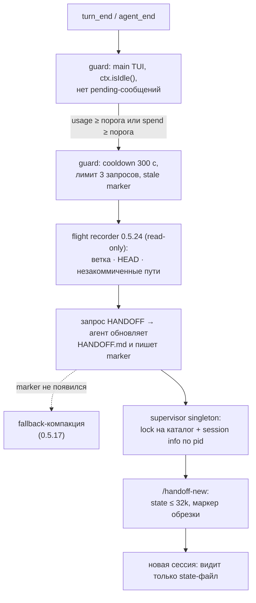

# Защиты OAW: что, зачем и где в цикле

Дата: 2026-11-27. Версия: `1.0.2`. Контракт — [contracts.md](contracts.md),
поток handoff — [handoff-flow.md](handoff-flow.md), диагностика —
[operations.md](operations.md), восстановление — [recovery.md](recovery.md).

OAW решает две разные задачи, и путать их нельзя:

| Задача | Что защищаем | Чем |
|---|---|---|
| **Контекст** | модель не деградирует и не теряет задачу на середине | пороги, handoff, fallback-компакция |
| **Данные** | файлы, ветки, сессии и terminal handle не теряются и не затираются | git-guard'ы, локи, атомарная запись, read-only снимки |

**Handoff — защита контекста, не файлов.** Он не коммитит, не мерджит и не
меняет рабочий каталог: `/handoff-new` открывает новую сессию в том же `cwd`
и вкладывает `continuePrompt` + state-файл. Всё, что защищает дерево от
затирания, стоит в отдельных точках — таблица ниже.

## Цикл и точки защиты



## Угрозы и защиты

| Угроза | Защита | Где срабатывает | С версии |
|---|---|---|---|
| Контекст переполнен, модель теряет задачу | warning 35% / suggest 50% / handoff на пороге; в `yoda-supervised` — 55% | `turn_end`, `agent_end` | 0.1, 0.3 |
| Сессия дорогая, хотя контекст ещё низкий (много коротких ходов/субагентов) | handoff по измеренному `usage.cost.total` (`handoffAtSpendUsd`); тот же cooldown/supervisor/`⚠ HANDOFF`, marker `reason: "spend"`; JSONL дочитывается offsets, перезапись/компакция пересчитывает total (без двойного счёта) | `checkHandoff`, `session_compact` | 0.7.0 |
| Handoff запрошен, но marker не появился | повтор через 2 завершённых хода, максимум 3 запроса, статус `⚠ HANDOFF` | `checkHandoff` | 0.5.15 |
| Handoff завис навсегда (нет supervisor) | fallback-компакция на `autoCompactPercent` после исчерпания повторов | `checkAuto` | 0.5.17 |
| Два supervisor на один каталог перехватывают marker | lock-dir `.omp-handoff-supervisor.lock/`, stale reclaim по мёртвому pid, release на сигналах | старт supervisor'а | 0.5.2 |
| Одноразовый `omp "…"` затирает terminal handle живой сессии | session info — карта по `pid`, merge + dead prune, lock + atomic rename | `session_start`, `session_switch` | 0.5.16 |
| Cleanup worktree убивает SIGTERM'ом живую сессию | guard: merged, clean, не current, нет процессов/JIT-терминалов; без `--force`/`-D`; ветка остаётся, tip в backup-ref | `/wrap`, `finish` | 0.5.14 |
| Commit в preflight утаскивает runtime-файлы или падает на `.gitignore` | add-all, затем снятие `.omp-handoff-*` с индекса; остались — abort | меню preflight | 0.5.23 |
| Незапушенные коммиты | действие `push` в меню preflight (только по выбору, `git push` без `--force`, отказ remote не форсится) | меню preflight | 0.5.26 |
| CLI `costs --json` отсутствует/упал/другая схема | строки `usage-border`/`usage-model` не выводятся; timeout 2 с, строгая проверка `schemaVersion: 1`, preflight не падает | `costsChecks` в preflight | 0.6.0 |
| State раздут и съедает контекст новой сессии | лимит 32 000 символов + маркер обрезки с полным размером и путём | `/handoff-new` | 0.5.8, 0.5.15 |
| State формально есть, но в нём нет цели/решений/проверок — новая сессия слепа | quality gate: warn по строке на отсутствующий ключевой раздел (синонимы, код-блоки не в счёт), одна строка для нестандартного формата; ничего не блокирует | `runPreflight` | 0.7.1 |
| Компакция выбросила детали уже после записи state | warn, если последняя компакция текущей сессии позже mtime `HANDOFF.md`; ручной фикс в блоке «вручную» | `runPreflight` | 0.7.1 |
| **Незакоммиченная работа не видна новой сессии** | **flight recorder: ветка, HEAD и до 6 грязных путей в тексте handoff-запроса** | `checkHandoff` перед `sendUserMessage` | **0.5.24** |
| Плагин мешает, когда не нужен | `workflowMode: off` — ни статуса, ни предупреждений, ни session info, launcher без supervisor | все хуки | 0.5.18 |
| Два владельца задач (`omp` и Ensemble) | `plan.execution: external` → stop `external-run`; `doctor` предупреждает `two owners` при JSON-статусе Ensemble (0.5.5 отдаёт только текст → `warn` unconfirmed) | `start/verify/finish/rebase`, `doctor` | 0.5.21 |
| **Subagent-сессии не видны в бюджете: прогон тратит в разы больше видимой суммы** | ledger: root + вложенные subagent-файлы, `spendUsd` = Σ вкладов, stop `budget-spend` на старте и после merge | `applyCost`, `start`, `finish`, `status` | **0.7.4** |
| **Компакция переписала JSONL: spend прыгает и даёт ложный stop** | `restarted` заменяет вклад файла (пересчёт с нуля), а не прибавляет полную сумму | `projectBudgets` | **0.7.4** |
| **Хвост прошлой сессии теряется на handoff** | перед сменой `run.sessionFile` старый root дочитывается тем же offset-чтением | `syncSession` | **0.7.4** |
| **CLI-скрипты не запускаются в установленной копии: Node не снимает типы под `node_modules`** | шимы `bin/` регистрируют `lib/ts-loader.mjs` (`node:module.stripTypeScriptTypes`); один код-путь для клона, tarball и `node_modules`; регрессия держится `test/package-run.test.mjs` | `bin/omp-orchestrate`, `bin/omp-next-session`, `bin/omp-preset`, `bin/omp-yoda` | **1.0.0** |
| **`force`-удаление worktree упавшей задачи уносит незакоммиченные файлы: backup-ref хранит только коммиты** | WIP-снимок до удаления: патч (tracked + untracked через временный индекс) и `.status` в `~/.local/state/omp-agent-workflow/wip/`; путь — в выводе `start` или в тексте ошибки; сбой снимка — отказ от удаления | `removeWorktree` при `force: true` | **1.0.1** |
| **Tip удалённой ветки не найти после cleanup** | read-only `omp-orchestrate refs` по `refs/omp-worktree-backup/*`; восстановление — `docs/recovery.md` | `refs`, `removeWorktree` (backup-ref) | **1.0.1** |
| **Экономика после handoff слепа: OMP удаляет JSONL родительской сессии при `newSession`** | best-effort копия файла (права 600, только локально) в `$XDG_STATE_HOME/omp-agent-workflow/sessions/` перед marker и перед `/handoff-new`; сбой копии — warning, handoff идёт дальше | `checkHandoff`, `/handoff-new` | **1.0.1** |

## 0.5.24: flight recorder

**Почему.** Handoff физически не может потерять незакоммиченные файлы — они
остаются на диске. Теряется **знание о них**: новая сессия видит только
`HANDOFF.md`, и если там нет строки про WIP, следующий commit смешает
старое и новое. Ошибка была не в том, где стоит handoff, а в том, что снимок
содержал только текст документа.

**Что добавлено.** В момент запроса (`checkHandoff`, последняя безопасная
граница — завершённый ход, `ctx.isIdle()`) extension делает read-only снимок
дерева и вставляет его в текст запроса:

```text
# до 0.5.24
HANDOFF: контекст 56% (56k/100k). Заверши текущую задачу, обнови HANDOFF.md,
запиши .omp-handoff-request.json с {...} и заверши ход. Не начинай новую задачу.

# с 0.5.24
HANDOFF: контекст 56% (56k/100k). Заверши текущую задачу, обнови HANDOFF.md,
запиши .omp-handoff-request.json с {...} и заверши ход.
Дерево: ветка feat/x @ 1a2b3c4, незакоммиченных файлов: 2 (M src/a.ts, ?? b.md).
Перечисли их в HANDOFF.md — новая сессия видит только файл. Не начинай новую задачу.
```

Свойства:

- три git-вызова (`rev-parse --abbrev-ref HEAD`, `rev-parse --short HEAD`,
  `status --porcelain`), timeout 3 с, без записи в репозиторий;
- runtime-файлы `.omp-handoff-*` исключены из списка; чистое дерево даёт
  «изменений нет»; не git-репозиторий — строка просто опускается;
- бюджет: до 6 путей и 300 символов на список, остальное — «и ещё N»;
- контракт файлов marker/session не меняется: снимок живёт только в тексте
  сообщения, модели его видно сразу, новой сессии — только через
  `HANDOFF.md`.

Код: `workingTreeSnapshot()` в `index.ts`; тесты — `test/context-guard.test.mjs`
(грязное дерево, чистое дерево, вне git, исключение runtime-файлов).

## 0.7.1: quality gate в preflight

**Почему.** Handoff передаёт новой сессии ровно один документ. Если в нём
нет цели, решений или проверок, файл существует и `/handoff-new` его
встроит, но следующая сессия начнёт без контекста, который был в старой.
Второй провал — компакция после записи state: разговор сжался, детали
исчезли из сессии, и в документе их уже не восстановить.

**Что добавлено.** Read-only проверки в `runPreflight`, до меню действий:

- шесть канонических разделов README (`цель`, `состояние`, `решения`,
  `файлы`, `проверки`, `дальше`) ищутся по заголовкам ATX и синонимам,
  включая английские; fenced-блоки пропускаются; найденный раздел даёт
  `pass` `разделы 6/6`, каждый отсутствующий — отдельный `warn`;
- синонимы покрывают чужие шаблоны: `Проверено как` → проверки,
  `Открыто`/`Что делать` → дальше, `Что закрыто`/`Что включено` →
  состояние, `Главные выводы` → решения;
- нестандартный формат без единого узнаваемого заголовка — одна строка
  `нестандартный формат — нет разделов шаблона OAW (вне OAW допустимо)`,
  а не шесть предупреждений; фикс — «оставить как есть или сверить с
  шаблоном»;
- `lastCompactionAt` из того же прохода по JSONL, что и метрики: если
  последняя компакция позже mtime `HANDOFF.md`, печатается warn; state,
  перезаписанный после компакции, предупреждения не даёт.

Находки не меняют `ready` и не попадают в меню автоматических действий:
точный фикс печатается строкой в блоке «вручную/агентом» и пропускается
вместе с остальными ручными шагами. `/handoff-new` по-прежнему проверяет
только наличие state-файла.

Код: `lib/state-sections.ts`, `stateSectionsChecks`/`compactionCheck` в
`index.ts`; тесты — `test/state-sections.test.mjs`,
`test/session-metrics.test.mjs` (gate и `lastCompactionAt`),
`test/context-guard.test.mjs` (ручной фикс в итоговом выводе).

## 0.7.4: леджер субагентов

**Почему.** Бюджет `maxSpendUsd` — обещание «столько не потратим». Считать
только корневую сессию нельзя: работа subagent'ов пишется в отдельные JSONL
рядом, и прогон с активными детьми легко тратит в разы больше видимой
суммы, не срабатывая ни на одном stop-gate. Вторая угроза — компакция:
OMP переписывает JSONL на месте, и наивное `spend += прочитанное` удваивает
сумму, после чего бюджет останавливает прогон по выдуманным деньгам.

**Что добавлено.**

- дерево прогона: root-файл + вложенные файлы subagent-сессий
  (`<root-stem>/**/*.jsonl`); цена — `usage.cost.total`;
- вклад каждого файла в `STATE.budgets.costTotals`; `spendUsd` = Σ вкладов:
  дельта прибавляется, перечитывание с нуля (`restarted`) заменяет вклад;
- сессии, выпавшие из текущего дерева после handoff, остаются вкладом
  `previous` — сумма не теряется при смене root;
- перед сменой `run.sessionFile` хвост прошлой сессии дочитывается, поэтому
  сообщения после последнего действия не исчезают из бюджета;
- `status --json` отдаёт `spend{measured,spentUsd,limitUsd,remainingUsd,
  exceeded,files[]}`, preflight — ту же функцию; гейты `start` и `finish`
  ставят stop `budget-spend` по этому числу;
- `measured: false` означает, что session-файл не читается: сумма известна
  только по прошлым измерениям, и гейт сообщает `cost-unavailable`, если
  лимит задан.

Старые `STATE.json` без `costTotals` читаются как пустая карта: `spendUsd`
остаётся накопленной суммой, ближайшая перезапись файла добавит его
целиком — лучшее, что можно восстановить без потери истории.

Код: `lib/orchestrator/cost.ts` (entries/readable), `ledger.ts`
(`projectBudgets`, `ledgerSnapshot`), `actions.ts` (applyCost, syncSession,
status), `index.ts` (preflight run row); тесты — `test/ledger.test.mjs`,
`test/orchestrator.test.mjs` (rewrite, tail, gates, status),
`test/contracts.test.mjs` (форма `spend`).

## 1.0.0: CLI-скрипты и `node_modules`

**Почему.** `npm install` и копия из маркетплейса кладут плагин под
`node_modules`, а Node отказывается снимать типы с файлов там
(`ERR_UNSUPPORTED_NODE_MODULES_TYPE_STRIPPING`). Раньше CLI запускались
через `node --experimental-strip-types` и в такой копии падали
(`omp-orchestrate` — с ошибкой, preset/advisory launcher'а — молча).

**Что добавлено.** Тело CLI живёт в `lib/cli/{orchestrate,next-session,preset}.ts`,
а `bin/` — тонкие шимы: регистрируют `lib/ts-loader.mjs` и импортируют тело.
Лоадер читает `.ts` через `fs` и снимает типы `node:module.stripTypeScriptTypes`,
поэтому обходит ограничение Node; для всех остальных URL он делегирует
штатному загрузчику. Требование — Node ≥ 22.13.

**Что это не даёт.** Не компиляцию и не кэш: типы снимаются на каждом
запуске (~10–20 мс на процесс), сборки в пакете нет. Frontmatter/JSX и
другие трансформации не поддерживаются — только strip, как и раньше.

Код: `lib/cli/*.ts`, `lib/ts-loader.mjs`, `bin/*`;
тест — `test/package-run.test.mjs`.

## 1.0.1: WIP-снимок перед `force`-удалением

**Почему.** Retry упавшей задачи (`start` на `current.status === "failed"`)
удаляет её worktree через `force`, потому что попытка может быть грязной и
не влитой. Коммиты при этом целы — backup-ref и переименованная ветка
`<branch>-failed-<ts>`, — но `--force` удаляет каталог вместе с
незакоммиченными файлами. Проба 2026-11-27: backup-ref содержал коммит,
WIP-файл исчез. Flight recorder handoff такой файл описывает, но не
сохраняет; новой сессии он тоже не видит.

**Что добавлено.** Перед удалением при `force: true` и грязном дереве
`removeWorktree` вызывает `captureWorkInProgress`:

- `git status --porcelain --untracked-files=all` — список путей и
  `dirty`-счётчик;
- патч через временный индекс (`GIT_INDEX_FILE`): `read-tree HEAD` +
  `add -A` + `diff --cached --binary HEAD`, то есть tracked-изменения и
  новые файлы, без изменения рабочего дерева и настоящего индекса;
- `<snapshot>.status` — ветка, HEAD, статус и готовая команда восстановления;
- имя: `<repo>-<branch>-<ISO-ts>` в `$XDG_STATE_HOME/omp-agent-workflow/wip/`.

Сбой снимка (нет каталога, git отказал) пробрасывается и **отменяет
удаление**: терять WIP молча нельзя. Путь к снимку входит в результат
`start` (`wip`) и в текст ошибки, если удаление всё-таки упало после снимка.

**Что это не даёт.** Ignored-файлы (`node_modules`, `.env`) в патч не
входят; снимок не заменяет коммит; автоматической очистки нет — срок
хранения выбирает владелец.

Код: `lib/orchestrator/wip.ts`, вызов в `removeWorktree`,
поле `wip` в `StartResult`; тесты — `test/worktree-remove.test.mjs`,
`test/orchestrator.test.mjs`; восстановление — [recovery.md](recovery.md).

## 1.0.1: `omp-orchestrate refs`

**Почему.** Backup-ref — единственный след коммитов удалённого worktree, но
узнать о нём можно было только через `git for-each-ref` по памяти. Гигиена
из «Страховка без sandbox»: ref'ы копятся и никем не чистятся.

**Что добавлено.** Read-only команда: `for-each-ref --sort=-committerdate`
по `refs/omp-worktree-backup/`, поля `ref`, `branch`, `sha`, `short`,
`subject`, `committedAt`; текст и `--json` (`schemaVersion: 1`). План
читается только ради `config.baseRepo`, без плана base выводится из git.
Ничего не пишет, refs не двигает; удаление ref'ов — по-прежнему вручную
(`git update-ref -d`).

Код: `lib/orchestrator/refs.ts`, `lib/cli/orchestrate.ts`;
тест — `test/refs.test.mjs`.

## 1.0.1: копия session JSONL перед handoff

**Почему.** OMP удаляет JSONL родительской сессии при `newSession`, поэтому
«до»-окно `omp-orchestrate economics` после `/handoff-new` было неизмеримо
задним числом: отчёт штатно писал «родительская сессия отсутствует» и
`null` в `--summary`. Терялось не поведение, а единственное доказательство,
что handoff стоил дорого.

**Что добавлено.** Best-effort копия файла в момент, когда handoff реально
начинается:

- `checkHandoff` — сразу после записи session info, до того как агент
  поставит marker;
- команда `/handoff-new` — после `waitForIdle()`, непосредственно перед
  `newSession` (последний шанс; сюда же приходит supervisor).

Файл: `$XDG_STATE_HOME/omp-agent-workflow/sessions/<session-stem>.handoff-<ts>.jsonl`,
права `600`, только локально, ничего не отправляется. Одна копия на
session-файл за процесс (повторные запросы не плодят архивы). `--wip-dir`
не влияет: это отдельный каталог. Сбой копии не блокирует handoff —
`warning` в TUI и обычный ход дальше.

**Что это не даёт.** Копия — снимок на момент запроса: ходы родителя после
запроса в неё не попадают. Автоочистки нет (срок хранения решает владелец),
и копия не заменяет счёт провайдера: `economics --session <копия>` читает
её как обычный session-файл, включая `usage.cost.total`.

Код: `lib/session-archive.ts`, вызовы в `index.ts`
(`archiveSessionOnce`); тесты — `test/session-archive.test.mjs`,
`test/context-guard.test.mjs` (запрос handoff, `/handoff-new`, сбой копии).

## Чем защита не является

- Не блокер: `/handoff-preflight` по-прежнему advisory, `/handoff-new`
  проверяет только наличие state-файла.
- Не сохранение diff в handoff: в запросе handoff — пути и статусы, не
  содержимое; WIP-снимок 1.0.1 — отдельная точка, только при
  `force`-удалении worktree.
- Копия session JSONL — снимок на момент запроса handoff: ходы родителя
  после запроса в неё не попадают, ignored-файлы WIP-снимок не покрывает
  (см. [recovery.md](recovery.md)).
- Не замена `HANDOFF.md`: строка в запросе — напоминание записать WIP в
  документ, иначе новая сессия его не увидит.
- Не защита от смены модели внутри сессии: модель задаётся при запуске
  (`--model`/пресет/advisory), не handoff'ом (D14).
