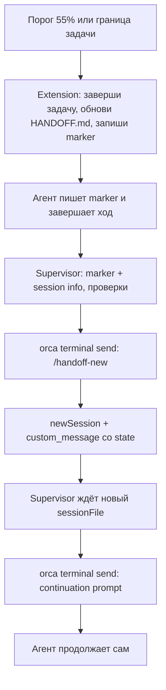

# Handoff: два пути

Дата: 2026-11-26. Версия: `0.5.24`. Стабильные схемы —
[contracts.md](contracts.md), поток и защиты — [guards.md](guards.md),
диагностика — [operations.md](operations.md), автоматический протокол —
[handoff-auto-plan.md](handoff-auto-plan.md).

Handoff в обоих случаях сохраняет состояние в `HANDOFF.md` и переносит его
в новую сессию. Разница в двух шагах: **кто вызывает `/handoff-new`** и
**кто отправляет первый user-message новой сессии**. `custom_message` со
state — это контекст, а не ход: без user-message агент не начинает работу.

## Общая часть

- `/handoff` — builtin OMP (алиас `/compact handoff`): компакция в текущей
  сессии; `HANDOFF.md` не пишет.
- `/handoff-new [файл]` — новая сессия: ждёт idle, проверяет state, вызывает
  `ctx.newSession({ parentSession, setup })`, добавляет `custom_message`:
  `continuePrompt` + содержимое state-файла. Лимит — 32 000 символов; при
  превышении добавляется маркер обрезки, при ошибке чтения — просьба
  прочитать файл самому.
- `cwd` новой сессии — `ctx.cwd`; запускать из корня проекта.
- `/handoff-preflight` — проверка и меню незакрытых действий; блокеры
  advisory.

## Путь A: только OMP, без Orca

**Что есть:** extension, пороги, `/handoff`, `/handoff-new`,
`/handoff-preflight`.

**Чего нет:** terminal handle. `writeSessionInfo` пишет `terminal: null`,
supervisor завершается с `no terminal handle; start OMP from Orca`.
Автоматической смены сессии нет.

Поток:

1. Агент или человек завершает задачу и обновляет `HANDOFF.md`.
2. `/handoff-preflight` → при необходимости `checks`, `commit`, `merge`.
3. `/handoff` (сжать контекст) или `/handoff-new` (новая сессия).
4. `/handoff-new` внедряет state и **не запускает ход**.
5. В новой сессии человек отправляет «продолжай» или любое другое сообщение.
6. Агент видит state в контексте и продолжает.

Режимы:

| Режим | Что работает |
|---|---|
| `manual` | только предупреждения; всё вручную |
| `assisted` | warning 35%, suggest 50%, авто-компакция 60%; handoff вручную |
| `yoda` | на 55% просит обновить state и записать marker; supervisor'а нет, marker остаётся; `/handoff` вручную |

`bin/omp-yoda` в этом режиме запускает supervisor, но тот не может отправить
команду и выходит; automatic handoff не срабатывает.

## Путь B: Orca + supervisor

**Что нужно:** OMP запущен в Orca-терминале (`ORCA_TERMINAL_HANDLE`),
supervisor запущен (`bin/omp-yoda` или
`node bin/omp-handoff-supervisor.mjs --dir .`), `orcaEnabled` и
`supervisorEnabled` включены.

Поток:

1. Extension на `session_start` пишет запись текущей сессии в
   `.omp-handoff-session.json` (`{sessions}`: `terminal`, `sessionFile`,
   `cwd`, `pid`); другие живые записи в этом cwd не затираются.
2. На пороге контекста 55% (в `yoda`/`yoda-supervised`), пороге
   `handoffAtSpendUsd` по измеренному spend сессии или на границе задачи
   агент получает указание: завершить задачу, обновить `HANDOFF.md`,
   записать `.omp-handoff-request.json` и закончить ход. Marker несёт
   `reason: "context"` или `"spend"`.
3. Supervisor читает marker и session info, выбирает запись по
   `marker.sessionFile`, проверяет terminal handle, `sessionFile`, cooldown
   300 с и stale grace.
4. Supervisor отправляет `/handoff-new` через
   `orca terminal send --enter`.
5. `/handoff-new` открывает новую сессию и внедряет state; ход не
   запускается.
6. Supervisor ждёт новый `sessionFile` (до 30 с), удаляет marker и
   отправляет continuation prompt через terminal. Это первый user-message;
   он и запускает агента.
7. Новая сессия на `session_start` ставит cooldown по `parentSession`;
   stale и ранние marker'ы отбрасываются.

Если supervisor не запущен, terminal handle потерян или
`orcaEnabled=false`, automatic handoff не срабатывает — остаётся путь A.

## Снимок дерева в запросе (0.5.24)

Запрос HANDOFF на пороге несёт read-only снимок рабочего дерева: ветку,
короткий HEAD и до 6 незакоммиченных путей (`M src/a.ts`, `?? b.md`),
остальное свёрнуто в «и ещё N». Runtime-файлы `.omp-handoff-*` в список не
попадают; чистое дерево даёт «изменений нет»; вне git-репозитория строка
опускается.

Зачем: handoff не трогает git, а новая сессия видит только `HANDOFF.md`.
Снимок заставляет агента перечислить WIP в документе, иначе следующие
правки смешаются со старыми в одном commit. Три git-вызова с timeout 3 с,
без записи в репозиторий; контракт marker/session не меняется. Полная карта
защит и мест в цикле — [guards.md](guards.md).

## Сравнение

| | OMP без Orca | Orca + supervisor |
|---|---|---|
| Кто вызывает `/handoff-new` | человек | supervisor |
| Кто отправляет первый user-message | человек («продолжай») | supervisor (continuation prompt) |
| Нужен terminal handle | нет | да |
| Авто-смена сессии | нет | да |
| Fallback | — | ручной путь A |

## Инварианты

- `/handoff-new` не запускает ход ни в одном пути.
- State — снимок на момент handoff; если `HANDOFF.md` устарел, новая
  сессия должна перечитать файл.
- Содержимое state попадает в файл сессии: секреты туда не писать.
- Supervisor — singleton на каталог; lock `.omp-handoff-supervisor.lock/`.
