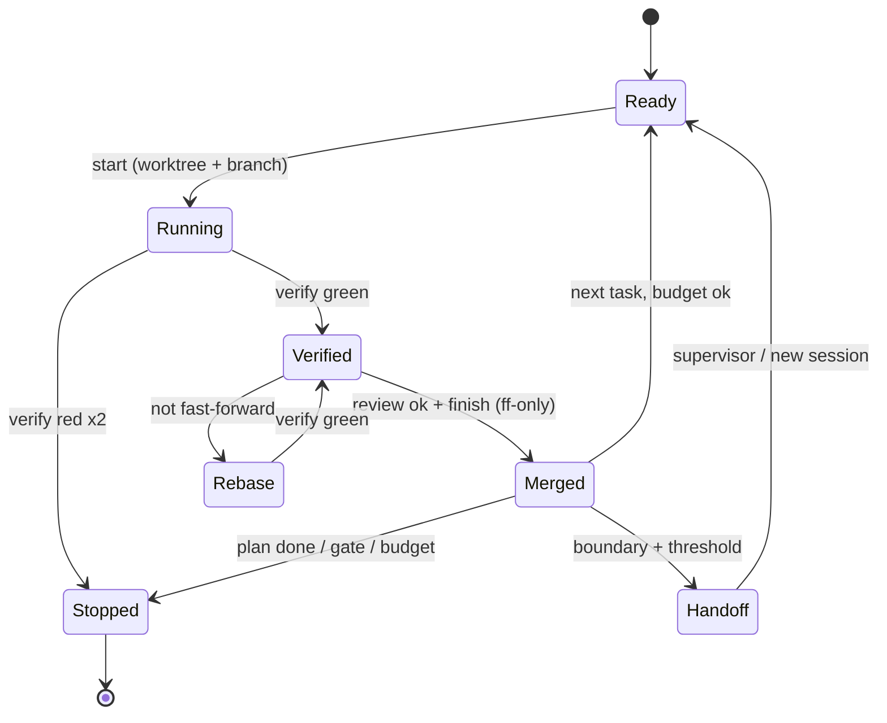

# Orchestrator и subagent-петля (0.5)

Статус: `[partial]`, дизайн утверждён 2026-11-22. Этап A реализован
(`plan.ts`, `state.ts`, `budgets.ts`, `policy.ts`, 25 unit-тестов); этапы
B–D впереди.

Цель: main-агент проходит `AUTOPLAN.md` до конца или stop-gate, детерминированно
выбирает задачи, создаёт worktree, проверяет, мержит и делает handoff на
границе задачи. Решения о компакции/handoff — политика, а не «модель
почувствовала».

## Роли

| Актор | Ответственность | Ограничения |
|---|---|---|
| **Orchestrator** (main) | Читает план/state, вызывает tool `orchestrator`, спавнит агентов, обновляет `HANDOFF.md` | Не редактирует код задачи; не мержит без verify/review |
| **Implementer** (`task`) | Одна задача, один worktree, код и тесты, коммит в `feat/<id>` | Работает только по абсолютному пути worktree |
| **Verifier** (`task`/`reviewer`) | Независимо повторяет `plan.verify` и acceptance | Не редактирует |
| **Reviewer** (`reviewer`) | Diff `base...branch`, риски, контракт | Не редактирует |
| **Scout** (`scout`) | Research, API, конкуренты | Read-only |
| **Supervisor** | Marker → `/handoff-new` → continuation | Без LLM |
| **Human** | Product-решения, gates, публикация | Может остановить run |

Важно: `task` tool не имеет `cwd`/worktree. Implementer получает абсолютный
путь worktree и обязан использовать `bash { cwd }` и абсолютные пути. Это
ограничение зафиксировано в [architecture.md](architecture.md).

## `AUTOPLAN.md`

Один источник истины: человеческий Markdown + строгие JSON-блоки. YAML не
используется.

````markdown
# AUTOPLAN — <цель>

```json plan
{
  "version": 1,
  "goal": "Orchestrator и subagent-петля",
  "baseBranch": "main",
  "baseRepo": null,
  "worktreeRoot": "~/orca/workspaces/omp-agent-workflow",
  "backend": "orca",
  "verify": ["npm test", "npm run typecheck"],
  "budgets": {
    "maxTasksPerSession": 3,
    "maxSpendUsd": 5,
    "maxMinutes": 120
  }
}
```

## T1 — state module

```json task
{
  "id": "T1",
  "title": "STATE.json и lock",
  "deps": [],
  "branch": "feat/t1-state",
  "files": ["lib/orchestrator/state.ts"],
  "acceptance": ["atomic write", "stale lock", "schema v1"],
  "verify": ["npm test"],
  "review": true,
  "gate": null
}
```
````

Поля `plan`:

| Поле | Обязательно | Default | Смысл |
|---|---|---|---|
| `version` | да | — | `1` |
| `goal` | да | — | Человеческая цель |
| `baseBranch` | нет | `main` | Куда мержить |
| `baseRepo` | нет | inferred | Путь к основному чекауту; иначе по `git-common-dir` |
| `worktreeRoot` | да | — | Каталог task-worktree |
| `backend` | нет | `orca` | `orca` или `git` (тесты/fallback) |
| `verify` | да | — | Команды по умолчанию; task может переопределить |
| `budgets` | нет | см. ниже | Лимиты run |

Поля `task`:

| Поле | Обязательно | Default | Смысл |
|---|---|---|---|
| `id` | да | — | Уникальный, `[A-Za-z0-9._-]+` |
| `title` | да | — | Короткое имя |
| `deps` | нет | `[]` | Зависимости по `id` |
| `branch` | нет | `feat/<id>` | Ветка задачи |
| `files` | нет | `[]` | Ожидаемые файлы (для review) |
| `acceptance` | да | — | Проверяемые критерии |
| `verify` | нет | `plan.verify` | Команды в worktree |
| `review` | нет | `true` | Требовать reviewer verdict |
| `gate` | нет | `null` | `publish`, `contract`, `data`, `human` → stop |

Валидация:

- уникальные `id`, непустые `title`/`acceptance`;
- `deps` существуют, циклов нет;
- `branch` безопасен (`^[A-Za-z0-9._/-]+$`, без `..`, не `main`);
- `verify` — непустые строки, разумный timeout;
- бюджеты — положительные числа;
- `gate` — из известного набора.

Hash: sha256 по каноническому JSON `plan` + всех `task` (ключи отсортированы).
Правка прозы не меняет hash; правка задач меняет → stop `plan-changed`.

## `STATE.json`

Runtime-файл в control worktree, gitignored. Один писатель через
`.omp-orchestrator.lock` (pid + timestamp; stale после 10 минут или мёртвого
pid). Запись — temp + `rename`.

```json
{
  "version": 1,
  "plan": { "path": "AUTOPLAN.md", "hash": "sha256:..." },
  "run": {
    "id": "2026-11-22T12-00-00Z",
    "active": true,
    "startedAt": "2026-11-22T12:00:00.000Z",
    "sessionFile": "/home/u/.omp/agent/sessions/.../session.jsonl",
    "mode": "yoda-supervised"
  },
  "current": {
    "id": "T2",
    "branch": "feat/t2",
    "worktree": "/home/u/orca/workspaces/omp-agent-workflow/t2",
    "status": "running | verified | reviewed",
    "commit": null,
    "startedAt": "2026-11-22T12:10:00.000Z"
  },
  "completed": [
    {
      "id": "T1",
      "commit": "abc123",
      "mergedAt": "2026-11-22T12:05:00.000Z",
      "checks": [{ "cmd": "npm test", "code": 0 }]
    }
  ],
  "attempts": { "T2": 1 },
  "budgets": {
    "tasksThisSession": 1,
    "spendUsd": 0.42,
    "costOffsets": { "/home/u/.omp/agent/sessions/.../session.jsonl": 12345 }
  },
  "context": { "percent": 42, "at": "2026-11-22T12:12:00.000Z" },
  "lastHandoff": { "at": "2026-11-22T11:00:00.000Z", "reason": "task-boundary" },
  "stop": null
}
```

Инварианты:

- `current` — не более одной задачи; `completed` — уникальные `id`.
- `run.active` = пользователь разрешил автоматическое продолжение.
- `stop` — причина и detail; без снятия `stop` новые subagent-спавны
  блокируются.
- `tasksThisSession` сбрасывается при смене `run.sessionFile`; spend/time —
  run-глобальные.
- `HANDOFF.md` коммитится, `STATE.json` — нет.
- Потеря/порча state → `state-missing`/`state-corrupt`, не replay задач.

## Действия

Tool `orchestrator` (`approval: "exec"`) и CLI `bin/omp-orchestrate` вызывают
одно и то же ядро.

| Action | Мутация | Предусловия | Результат |
|---|---|---|---|
| `status` | нет | — | plan/state/current/budget summary |
| `next` | нет | plan валиден, hash совпадает | следующий ready task или stop reason |
| `start [id]` | worktree, branch, state | deps, gate, budget, branch свободен | task spec + worktree + prompt |
| `verify [id]` | запуск команд, state | current совпадает | checks, `status: verified` |
| `finish [id] --commit SHA --review ok` | ff-only merge, cleanup, state | verified, HEAD == SHA, clean base, review | `continue / handoff / stop` |
| `rebase [id]` | rebase на base + verify | non-ff | новый commit, снова verified |
| `stop --reason R` | state.stop | — | причина и detail |
| `resume` | снять stop | plan/hash валидны | run.active |

Команды:

```bash
bin/omp-orchestrate status [--json]
bin/omp-orchestrate next [--json]
bin/omp-orchestrate start T1 [--json]
bin/omp-orchestrate verify T1 [--json]
bin/omp-orchestrate finish T1 --commit SHA --review ok [--json]
bin/omp-orchestrate rebase T1 [--json]
bin/omp-orchestrate stop --reason gate [--json]
bin/omp-orchestrate resume [--json]
```

`start` выводит готовый промпт implementer'а: JSON task, абсолютный worktree,
запрет трогать base, требование коммита и тестов. Модель не выбирает
worktree/branch — это делает код.

## Петля



1. `/orchestrate` валидирует план, ставит `run.active`, вызывает `start` для
   первого ready task.
2. Main спавнит implementer (`task`) с полным task JSON.
3. `verify` гоняет команды в worktree; verifier-subagent повторяет.
4. Reviewer смотрит diff; verdict `ok` передаётся в `finish`.
5. `finish` проверяет инварианты, мержит, обновляет state и считает policy.
6. Continue: extension на `agent_end` один раз отправляет промпт следующего
   task.
7. Handoff: инструкция обновить `HANDOFF.md` и записать marker
   `{ "reason": "task-boundary", "sessionFile": "..." }`.
8. Stop: причина в `STATE.stop`, continuation больше не отправляется.

## Политика

Чистая функция `decide(state, plan, contextPercent, now, mode)`.

| Условие | Решение | `reason` |
|---|---|---|
| `state.stop` уже есть | stop | как записано |
| нет ready task / все done | stop | `plan-done` |
| `deps` не разрешимы / цикл | stop | `no-ready-task` |
| у task `gate` | stop | `gate` |
| 2 неудачных verify | stop | `attempts-exceeded` |
| `spendUsd > maxSpendUsd` | stop | `budget-spend` |
| `elapsed > maxMinutes` | stop | `budget-time` |
| spend недоступен при заданном лимите | stop | `cost-unavailable` |
| `tasksThisSession >= max` и supervised | handoff | `task-boundary` |
| `tasksThisSession >= max` и `yoda` | stop | `budget-tasks` |
| boundary и `percent >= handoffAt` | handoff | `task-boundary` |
| иначе | continue | — |

Дополнительные stop reasons: `plan-missing`, `plan-invalid`,
`plan-changed`, `state-missing`, `state-corrupt`, `base-dirty`,
`merge-conflict`, `verify-failed`, `handoff-unavailable`.

Порядок приоритетов: stop → handoff → continue. Auto-compaction остаётся
ответственностью 0.3; orchestrator его не дублирует.

## Бюджеты

| Лимит | Семантика | Действие |
|---|---|---|
| `maxTasksPerSession` | Задач, завершённых в текущей сессии | supervised → handoff (счётчик сбрасывается); `yoda` → stop |
| `maxSpendUsd` | Run-глобально, root + subagent-сессии | stop |
| `maxMinutes` | От `run.startedAt`, handoff не сбрасывает | stop |

Spend:

- читается из session JSONL: `message.assistant.usage.cost.total`;
- root session + дочерние сессии по `parentSession`;
- инкрементально по byte offsets, offsets в `STATE.budgets.costOffsets`;
- если файл усечён/сменён — offset сбрасывается;
- native `omp --max-cost` — жёсткий backstop, но per-session; STATE считает
  run-глобально.

## Handoff на границе

Выбрано: **агент пишет marker после обновления `HANDOFF.md`** (существующий
протокол). Tool только сообщает `handoffRequired` и причину.

Почему не tool пишет marker сразу: supervisor может сменить сессию до того,
как агент обновит `HANDOFF.md`, и новая сессия прочитает старый state.
Машинный `STATE.json` уже на диске, поэтому худший случай — устаревший
человеческий summary, а не потеря прогресса.

Правила:

- marker только в main TUI, с текущим `sessionFile`;
- cooldown 300 с;
- после marker continuation не отправляется — supervisor/`/handoff-new`
  начинает новую сессию;
- `HANDOFF.md` обязан содержать следующий шаг и указатель на
  `AUTOPLAN.md`/`STATE.json`;
- в `yoda` без supervisor boundary-handoff не запрашивается: stop
  `budget-tasks` или ручной `/handoff`.

## Worktree и merge

- Base repo: `baseRepo` из плана или `dirname(git --git-common-dir)`;
  текущий worktree не считается base.
- `backend: "orca"`: `orca worktree create --repo ... --name ... --branch ...
  --base-branch ... --no-parent --json`; удаление — `orca worktree rm
  --worktree path:<path> --delete-branch`.
- `backend: "git"`: `git worktree add -b <branch> <path> <base>`; удаление —
  `git worktree remove` + `git branch -d`.
- Перед `finish`: base на `baseBranch`, `git status --porcelain` пуст,
  worktree HEAD == `--commit`, нет незакоммиченных изменений.
- Merge только `git merge --ff-only <branch>`.
- Non-ff → `rebase` action: rebase на base в worktree, повторный verify,
  новый commit, затем `finish`.
- Конфликт → stop `merge-conflict`, worktree сохраняется.
- После merge — удалить worktree и ветку, записать commit в `completed`.
- Параллельные задачи в 0.5 запрещены: один `current`.

## Extension-интеграция

Новый entry `orchestrator.ts`; `index.ts` не меняется. `package.json`:
`omp.extensions += "./orchestrator.ts"`, `files += "lib"`.

| Hook | Поведение |
|---|---|
| `/orchestrate [plan]` | Валидация, `run.active`, `start` первого task, prompt |
| `/orchestrate-stop [reason]` | `stop` |
| `agent_end` | Отправить pending continuation один раз; игнорировать `willContinue`/`awaitingAsyncWork` |
| `before_subagent_spawn` | Блокировать при `state.stop` или budget hard stop |
| `session_start` | Прочитать state; при незавершённом `current` — notify «продолжи через /orchestrate», без автоспавна |
| `tool` `orchestrator` | Действия из таблицы |

Все hooks проверяют `ctx.agent.kind === "main"` и `ctx.mode === "tui"`.
Subagent-сессии не продолжают цикл и не пишут marker.

Auto-continue:

- только `yoda`/`yoda-supervised`;
- только после явного `/orchestrate`;
- только после успешного `finish`;
- один pending prompt, очищается перед отправкой;
- `manual`/`assisted` никогда не продолжают сами.

## Файлы

| Путь | Роль |
|---|---|
| `lib/orchestrator/plan.ts` | Parse/validate/hash `AUTOPLAN.md` |
| `lib/orchestrator/state.ts` | Lock, atomic write, schema v1 |
| `lib/orchestrator/policy.ts` | Чистая политика continue/handoff/stop |
| `lib/orchestrator/budgets.ts` | Tasks/time/spend, причины |
| `lib/orchestrator/cost.ts` | Session JSONL, offsets, subagents |
| `lib/orchestrator/worktrees.ts` | Orca/git backend, merge/rebase/cleanup |
| `lib/orchestrator/actions.ts` | start/verify/finish/rebase/stop/resume |
| `orchestrator.ts` | Tool, команды, hooks |
| `bin/omp-orchestrate` | CLI |
| `test/orchestrator.test.mjs` | Unit + integration |
| `docs/orchestrator.md` | Эта страница |

## Тесты

Unit:

- парсинг плана: валидный, дубли `id`, неизвестная зависимость, цикл,
  небезопасная ветка, невалидные бюджеты;
- hash: изменение прозы не меняет, изменение task меняет;
- state: atomic write, lock, stale lock, порча JSON;
- policy: таблица решений и границы ровно на пороге;
- budgets: tasks/time/spend, `cost-unavailable`;
- cost: фикстуры JSONL, дочерние сессии, усечение файла, битые строки.

Integration (temp git repo, `backend: "git"`, без Orca и сети):

- `start` создаёт branch/worktree и state;
- `verify` запускает команды в worktree;
- `finish` отказывает при грязном base, чужом commit, отсутствии verify;
- happy path: merge ff-only, cleanup, `completed`;
- non-ff → `rebase` → verify → finish;
- stop-gate при второй неудаче.

Extension (fake ctx, как в 0.3-тестах):

- `/orchestrate` валидирует и стартует;
- continuation отправляется один раз;
- stop блокирует `before_subagent_spawn`;
- handoff-boundary не отправляет continuation;
- `manual` не продолжает;
- 19 тестов 0.3 остаются зелёными.

## Этапы

| Этап | Содержимое | Acceptance | Статус |
|---|---|---|---|
| A | `plan.ts`, `state.ts`, `budgets.ts`, `policy.ts`, тесты | Unit зелёные, typecheck | `[готово]` |
| B | `cost.ts`, `worktrees.ts`, `actions.ts`, CLI | Integration на temp git repo | `[next]` |
| C | `orchestrator.ts`, tool, команды, hooks; spike второго entry | Fake-ctx тесты; extension грузится в OMP | `[future]` |
| D | docs/example, README/AGENTS/ROADMAP/HANDOFF, `0.5.0` | E2E 3 задачи, handoff, stop-gate | `[future]` |

Работа — в текущем worktree `feat/orchestrator`, коммиты по этапам, merge в
`main` после зелёных проверок.

## Acceptance 0.5

- 3 задачи подряд с тестами/typecheck, каждая merged ff-only.
- Handoff на границе не теряет `STATE.json`; новая сессия читает
  `HANDOFF.md` + `AUTOPLAN.md` и продолжает без повторов.
- Stop-gate останавливает с причиной; новых subagent-спавнов нет.
- `npm test`, `npm run typecheck`, загрузка extension в OMP.
- Нет runtime-зависимостей, `any`, секретов и незакоммиченных файлов.

## Риски

| Риск | Митигация |
|---|---|
| `task` не имеет cwd | Абсолютные пути, `bash { cwd }`, verifier проверяет чистый base и diff scope |
| Cost JSONL зависит от версии OMP | Терпимый парсер, фикстуры, native `--max-cost` |
| Auto-continue зациклится | Продолжение только после успешного `finish`, один pending prompt, stop при ошибке |
| Base грязный из-за другого агента | `stop: base-dirty`, не мержить |
| Reviewer verdict — заявление модели | Детерминированы verify, SHA, clean base, diff; reviewer обязателен по умолчанию |
| Orca CLI JSON меняется | Backend-интерфейс + git fallback |
| Долгий verify блокирует UI | Async exec, timeout, progress |

## Non-goals 0.5

- Параллельные задачи и несколько `current`.
- Multi-repo run.
- Интеграция с Orca orchestration Runs/gates.
- Автоматический merge без reviewer/verify.
- Публикация npm/marketplace и remote.
- Изменение контракта 0.3, supervisor или `index.ts`.
- Работа в `manual`/`assisted` без явного `/orchestrate`.
