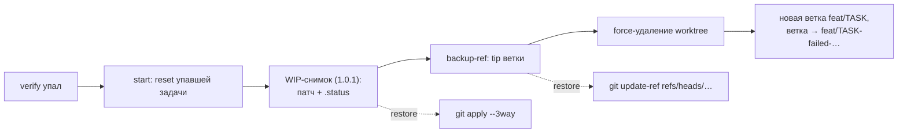

# Восстановление: ветки, worktree и незакоммиченная работа

Дата: 2026-11-27. Версия: `1.0.1`. Карта защит — [guards.md](guards.md),
runbook — [operations.md](operations.md), инцидент с SIGTERM —
[operations.md#инцидент-2026-11-23](operations.md).

OAW ничего не удаляет без следа: cleanup worktree оставляет ветку, tip —
в backup-ref, а `force`-удаление сначала снимает незакоммиченную работу в
патч. Этот документ — что именно переживает удаление, где это лежит и как
вернуть.

## Что где переживает

| Что | Где переживает | Как вернуть |
|---|---|---|
| Коммиты удалённой ветки | `refs/omp-worktree-backup/<branch>-<epoch-ms>` в base-репозитории | `git update-ref refs/heads/<branch> <backupRef>` |
| Сама ветка (обычный cleanup) | локальная ветка не удаляется (`git branch -d` только по явному выбору) | ничего не нужно |
| Переименованная упавшая ветка | `<branch>-failed-<timestamp>` в base-репозитории | `git branch -m` обратно |
| Незакоммиченные файлы упавшей задачи | патч в `~/.local/state/omp-agent-workflow/wip/` | `git apply --3way <patch>` |
| List/типы путей, HEAD и ветка WIP | `<snapshot>.status` рядом с патчем | прочитать |
| Игнорируемые файлы (`node_modules`, `.env` и т.п.) | нигде: в патч не входят осознанно | переустановить/пересоздать |
| JSONL родительской сессии после `/handoff-new` | нигде: OMP удаляет файл при `newSession` | «до»-окно economics не восстановить |

## Цикл: где стоит снимок



До 1.0.1 backup-ref спасал коммиты, но не WIP: `force` удалял каталог
вместе с незакоммиченными файлами (проба 2026-11-27). Теперь снимок стоит
до удаления, а его сбой — отказ от удаления.

## Посмотреть backup-ref

```bash
node bin/omp-orchestrate refs            # текст
node bin/omp-orchestrate refs --json     # schemaVersion: 1
```

Read-only: команда не двигает refs и не пишет state. План читается только
ради `config.baseRepo`; без `AUTOPLAN.md` base-репозиторий выводится из git
(`--git-common-dir`). Колонки: короткий sha, дата коммита, имя ветки без
префикса и метки времени, subject. Поле `branch` приблизительное: слэши
ветки заменены дефисами, а метка времени отрезается по `-\d{10,}`; полное
имя — в `ref`.

Backup-ref пишет только OAW: `removeWorktree` (`/wrap`, `finish`, retry
упавшей задачи). Прямой `orca worktree rm` (runbook для своей рабочей
копии) ref не создаёт — ветка при этом остаётся, но после `git branch -d`
refs восстанавливать будет нечего. При ручном cleanup либо оставьте ветку,
либо снимите ref заранее:

```bash
tip=$(git -C <base-repo> rev-parse <branch>)
git -C <base-repo> update-ref "refs/omp-worktree-backup/<branch-slug>-$(date +%s%3N)" "$tip"
```

## Вернуть ветку из backup-ref

```bash
git -C <base-repo> for-each-ref refs/omp-worktree-backup/     # найти ref
git -C <base-repo> update-ref refs/heads/<branch> <backupRef> # вернуть имя
git -C <base-repo> worktree add <path> <branch>               # или сразу worktree
```

Ref'ы переживают `git gc --prune=now` (проверено на одноразовом репозитории,
2026-11-27). `git branch <branch> <backupRef>` — то же самое; `update-ref`
нужен, когда ref удалён, а tip известен только из вывода.

## Вернуть незакоммиченную работу

Снимок создаётся при `start` на `failed`-задаче, если дерево грязное, и
путь печатается в выводе `start` (`wip:`/`wip-status:`) или в тексте ошибки
`cannot reset failed task …; WIP сохранён: <patch>`. В JSON — поле
`wip{patchPath,statusPath,repo,branch,head,files,patchBytes}`.

```bash
git -C <worktree> apply --3way <patchPath>     # tracked + untracked
git -C <worktree> status --short               # сверить со .status
```

Патч содержит `diff --cached HEAD` временного индекса: модификации tracked-
файлов и новые (untracked) файлы; рабочее дерево и настоящий индекс при
снятии не менялись. Восстанавливать лучше в чистом worktree той же базы
(например, в новом worktree задачи после `start`): `--3way` разрешает
конфликты, если база успела сдвинуться, и печатает «Falling back to direct
application» для новых файлов — это ожидаемо.

Ограничения:

- ignored-файлы не попадают в патч: это снимок `git add -A`, а не образ
  каталога;
- большие бинарники попадают в патч как `--binary` — размер снимка равен
  размеру изменений;
- режимы прав и submodule-указатели восстанавливаются как обычный `git apply`.

## Гигиена

- `~/.local/state/omp-agent-workflow/wip/` и `refs/omp-worktree-backup/*`
  не чистятся автоматически. Срок хранения выбирает владелец; удалять,
  когда tip/патч больше не нужны:
  `git -C <base> update-ref -d <backupRef>` и `rm <snapshot>.patch <snapshot>.status`.
- `XDG_STATE_HOME` уважается; `--wip-dir PATH` (CLI) или `wipDir` в
  `ActionContext` перенаправляют снимки (используется тестами).
- Снимок пишется до удаления: если каталог снимков недоступен, удаление
  отклоняется и worktree остаётся на месте.
